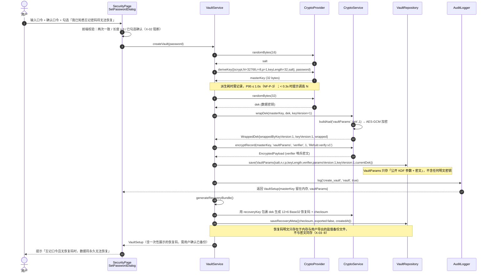
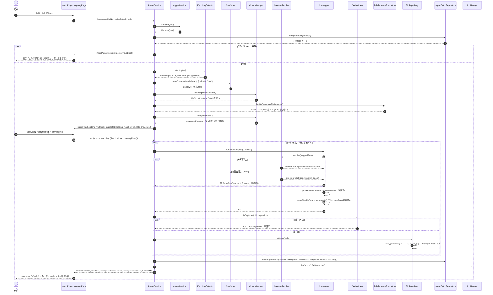
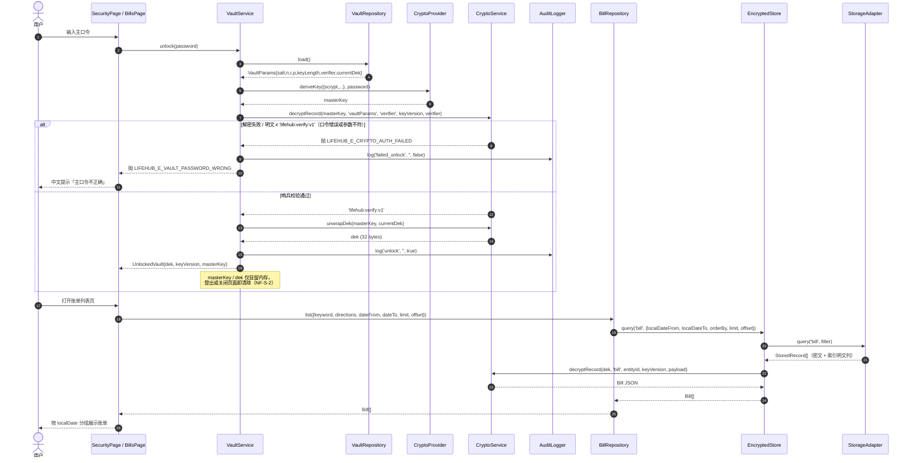
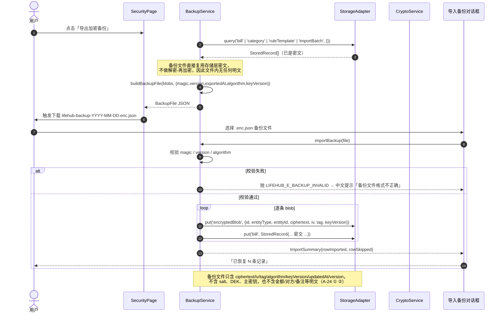
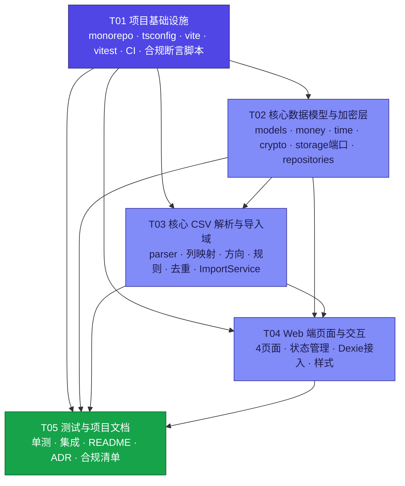

# LifeHub 系统设计文档（System Design）

> 文档版本：v1.0 ｜ 日期：2026-10-30 ｜ 作者：高见远（架构师）
> 上游输入：`docs/PRD.md` v1.0（许清楚 / 产品经理）
> 配套文档：`docs/roadmap.md`（任务分工矩阵）、`docs/class-diagram.mermaid`、`docs/sequence-diagram.mermaid`、`docs/task-dependency-graph.mermaid`
> 本文档不含实现代码；代码由工程师按 §3 / §7 / §8 的签名与约定撰写。

---

## 目录

**Part A · 系统设计**
1. [实现方案](#1-实现方案)
2. [文件清单](#2-文件清单)
3. [数据结构与接口](#3-数据结构与接口)
4. [程序调用流程](#4-程序调用流程)
5. [待明确事项与设计假设](#5-待明确事项与设计假设)

**Part B · 任务分解**
6. [依赖包列表](#6-依赖包列表)
7. [任务列表](#7-任务列表)
8. [共享知识（跨文件约定）](#8-共享知识跨文件约定)
9. [任务依赖图](#9-任务依赖图)

---

# Part A · 系统设计

## 1. 实现方案

### 1.1 目标与边界

本轮（Sprint 0）交付 PRD §4.3 的 4 项 + 3 条红线：

| 交付项 | 对应 PRD 条目 |
| --- | --- |
| ① 核心 TS 层数据模型（账单 / 分类 / 规则模板） | A-01、A-02、A-03、A-13、X-08 |
| ② CSV 解析器（支持自定义列头映射） | A-04、A-05、A-06、A-10、A-11 |
| ③ AES-GCM 加解密封装（密钥由口令派生） | A-07、X-01 ~ X-04、X-07、X-09 |
| ④ Web 端最小可跑页面：导入 CSV → 原始账单列表 | A-08、A-09、A-12、A-13 |
| ⑤ 合规与隐私红线 | X-05、X-06、X-15 |
| ⑥ 审计日志 | X-07 |

**不在本轮范围**：课表 / 习惯 / 日记 / AI / 同步服务 / Flutter 壳 / 图表 / 预算信封 / 多格式解析（Excel/PDF/txt）。这些在 `docs/roadmap.md` 的 12 周路线图中排期；本轮只预留**模型与接口地基**（`ScheduleSlot` / `Habit` / `DiaryEntry` / `AIAnalysisRequest` / `EncryptedBlob` 的类型定义与 `EntityType` 枚举位）。

### 1.2 核心技术难点与解决策略

#### 难点 1：时区与跨天（PRD §3.2、§7 隐藏坑 1）

| 问题 | 方案 | 落地位置 |
| --- | --- | --- |
| 「今天 / 本周 / 连续天数」按 UTC 截断会算错 | 存储双时间：`occurredAt`（ISO 8601 UTC）+ `localDate`（`YYYY-MM-DD`，按用户时区换算）；**所有跨天判定一律比较 `localDate` 字符串**，绝不做时刻差运算 | `packages/core/src/time/datetime.ts` |
| 不引入 `moment` / `dayjs` / `date-fns`（体积 + 跨端行为差异） | 使用 **ECMAScript 内置 `Intl.DateTimeFormat`** 做时区换算：Node 22 与浏览器行为一致，且 Flutter/Dart 侧有等价实现 | 同上 |
| 账单来源时区丢失 | 额外存 `sourceTimeZone`（IANA 名），导入时由文件内容 / 系统时区推断，保留来源语义 | `packages/core/src/time/time-zone.ts` |
| 币种小数位 | v1 仅 `CNY`（exponent = 2）；`currency` 字段预留，`exponent` 查表函数已按 `CURRENCY_EXPONENT` 常量表实现，后续加 `JPY`/`KWD` 只改常量 | `packages/core/src/money/currency.ts` |

```ts
// packages/core/src/time/datetime.ts（对外签名）
export function toLocalDate(instant: Date, timeZone: string): string;   // → '2024-06-03'
export function formatIsoUtc(instant: Date): string;                     // → '2024-06-03T08:12:00.000Z'
export function parseFlexibleDate(raw: string, opts?: ParseDateOptions): ParsedDate;
export interface ParsedDate {
  occurredAt: string;     // ISO 8601 UTC
  localDate: string;      // YYYY-MM-DD（按 opts.timeZone）
  sourceTimeZone: string;
  matchedFormat: string;  // 命中的格式标识，用于 dateFormatHints
}
```

> `toLocalDate` 用 `Intl.DateTimeFormat('en-CA', { timeZone, ... }).formatToParts()` 拼装 `YYYY-MM-DD`，避免 `en-CA` 区域格式在个别实现下退化。

#### 难点 2：金额精度（PRD §3.2、Q3）

| 问题 | 方案 | 落地位置 |
| --- | --- | --- |
| `0.1 + 0.2` 浮点误差导致账单求和对不上 | 存储一律 `amountMinor: number`（整数分），运行时用 `Number.isInteger` 校验 | `packages/core/src/models/bill.ts` |
| 解析 `"1,234.56"` / `"¥12.34"` / `"￥-35.00 元"` / 全角数字 时用 `parseFloat` 引入误差 | **字符串级解析**：剥离货币符号、千分位、全角字符后，按小数点切分，字符串转整数，**全程不经过 `parseFloat`**。**剥离货币符号在识别负号之前**，否则 `￥-35.00 元` 这类写法的负号会被漏掉；负号口径由 `money/amount-sign.ts` 的 `normalizeAmountText()` 统一维护，解析与方向推断共用 | `packages/core/src/money/amount.ts` + `packages/core/src/money/amount-sign.ts` |
| 展示格式化回流污染存储 | `formatMinor(amountMinor, currency)` 只用于渲染，**禁止把其返回值写回存储**（`Shared Knowledge §8.2` 约定） | 同上 |

```ts
export function parseAmountToMinor(raw: string, opts?: ParseAmountOptions): number; // 抛 LIFEHUB_E_AMOUNT_INVALID
export function formatMinor(amountMinor: number, currency?: CurrencyCode): string; // '12.34'（仅展示）
export function sumMinor(values: readonly number[]): number;                      // 整数求和，零浮点
```

#### 难点 3：加密封装边界（PRD X-01、X-08、A-07、Q4）

| 问题 | 方案 |
| --- | --- |
| 核心层不得直接调用 `window.crypto` | 定义 `CryptoProvider` **端口接口**，实现由外部注入；核心层只依赖接口 |
| WebCrypto **不支持 scrypt**（只支持 PBKDF2 / HKDF），而 PRD 已拍板 scrypt | `CryptoProvider.deriveKey()` 抽象掉算法；Web 端实现用 `@noble/hashes/scrypt`（纯 JS，浏览器/Node/未来 WASM 均可），Node 端实现用 `node:crypto.scrypt`（更快） |
| AES-GCM 性能 | 一律走**平台原生** `crypto.subtle`（浏览器与 Node 22 均有）；纯 TS 仅作**兜底**（`@noble/ciphers`），不作为默认路径 |
| 加密模块零网络出口（X-01 ①） | `packages/core/src/crypto/**` 内禁止出现 `fetch`/`XMLHttpRequest`/`WebSocket`/`sendBeacon`；由 `scripts/check-no-network-in-crypto.mjs` 做 CI 静态断言 |
| 篡改必须失败且不返回部分明文（NF-S-4） | `decrypt()` 捕获底层认证失败，统一抛 `LIFEHUB_E_CRYPTO_AUTH_FAILED`，**不返回任何部分明文** |
| 密钥永不上传 | 核心层对外导出的类型中不存在任何接收明文业务数据的同步接口；同步载荷由 `buildSyncPayload()` 构造，只接受 `EncryptedBlob[]` |

**可移植边界（明确写死）**：

```
┌──────────────────────────────────────────────────────────────┐
│  packages/core  —— 纯 TS 领域逻辑                             │
│  models / money / time / csv / rules / storage(接口) /      │
│  repositories / services(除加密实现)                        │
│  ✅ 零 DOM ✅ 零 React ✅ 不直接 import node:crypto           │
└───────────────┬──────────────────────────────────────────────┘
                │ 依赖注入两个端口
      ┌─────────┴──────────┐
      ▼                    ▼
┌───────────────┐   ┌──────────────────┐
│ CryptoProvider│   │ StorageAdapter   │
│  (端口)        │   │  (端口)          │
└───┬───┬───┬───┘   └────┬────────┬────┘
    │   │   │            │        │
    ▼   │   ▼            ▼        ▼
 WebCrypto Node  Noble   Dexie    Memory
 (浏览器) (Node)(兜底) (IndexedDB)(测试)
```

> **关键约束**：加密核心的**密码学运算全部走平台原生实现**（WebCrypto / node:crypto / 未来 Android Keystore / iOS Keychain），TS 只做**接口抽象、参数序列化、AAD 构造、错误归一**。这条边界保证未来 Flutter 端只需替换 `CryptoProvider` 实现，领域逻辑一行不改（对应 PRD §6.2「架构师在设计阶段即确定加密核心的可移植边界」）。

#### 难点 4：CSV 大文件性能（PRD A-04 ⑥、NF-P-1）

| 问题 | 方案 |
| --- | --- |
| 10 万行 / 10MB ≤ 3s | **不使用 papaparse**：手写**流式状态机解析器**，逐行产出，不把整表驻留内存 |
| 大文件读入内存 | Web 端用 `File.stream()` + `TextDecoder` 流式解码（`{stream:true}`），**不读全量 ArrayBuffer** |
| GBK 回退 | `TextDecoder('gbk')` 属于 WHATWG 编码标准（Chrome/Edge/Node 22 全 ICU 均支持）；检测策略：先试 UTF-8 严格解码 → 失败试 GBK 严格解码 → 仍失败则 UTF-8 宽松解码并记录告警。**零第三方依赖** |
| 多字节字符跨 chunk 截断 | 使用 `TextDecoder` 的流式模式，decoder 内部保留未完成字节 |
| 解析与映射重复占用内存 | `ImportService.run()` 在**同一次流式遍历**中完成「解析 → 映射 → 方向推断 → 去重 → 落库」，只保留待写入缓冲（默认 1000 条一批） |

```ts
export class CsvParser {
  constructor(options?: CsvParserOptions);                            // { delimiter?: 'auto'|string, quote?: string, trimHeader?: boolean }
  parse(text: string, options?: ParseOptions): CsvTable;               // 同步全量（供测试与小文件）
  parseRows(text: string, options?: ParseOptions): string[][];
  parseStream(chunks: AsyncIterable<Uint8Array | string>, options?: ParseOptions): AsyncGenerator<CsvRow>;
}
```

#### 难点 5：冲突合并（PRD X-11、§7 隐藏坑 3）

| 问题 | 方案 |
| --- | --- |
| 双端并发改同一条记录不能静默丢字段 | 采用**三方合并（Three-way Merge）**：`mergeRecord(local, remote, base)`。`base` = 上次同步后的共同祖先快照，存于本地 `syncBase` 表 |
| 同版本冲突需要确定性结果（不依赖设备执行顺序） | 字段级 LWW 决胜键 = `(updatedAt, deviceId)` 字典序比较，**与到达顺序无关** |
| 无 base 时（首次同步） | 退化为「整条记录 LWW + 全字段差异记入 `conflicts[]`」，并把 `local` 写入 `syncBase` 作为新的 base |

```ts
export function mergeRecord<T extends MergeableEntity>(
  local: T | null, remote: T, base: T | null,
): MergeResult<T>;
export interface MergeResult<T> {
  merged: T; changed: boolean;
  conflicts: FieldConflict[];   // { field, localValue, remoteValue, winner: 'local'|'remote' }
}
```

**三方合并规则表**：

| local vs base | remote vs base | 结果 | 冲突 |
| --- | --- | --- | --- |
| 相同 | 相同 | 保留 | 否 |
| 不同 | 相同 | 取 local | 否 |
| 相同 | 不同 | 取 remote | 否 |
| 不同 | 不同（值相等） | 取该值 | 否 |
| 不同 | 不同（值不等） | LWW：`(updatedAt, deviceId)` 大者胜 | 是，记入 `conflicts[]` |

> 该规则满足 X-11 验收：双端改不同字段 → 两字段均保留；双端改同一字段 → 取较新者且结果确定。

#### 难点 6：密钥轮换（PRD X-10、§7 隐藏坑 5）

| 问题 | 方案 |
| --- | --- |
| 改主密码后历史密文要重加密 | 主密钥只包裹 DEK；轮换时**换 DEK、不换主密码语义**：`newMaster` 包裹 `oldDek`（双重包裹存 `previousDek`），再逐条用 `oldDek` 解 → `newDek` 加 → 更新 blob |
| 轮换中断 | 轮换作业状态持久化在 `rotationState` 实体（`jobId` / `processedRecords` / `cursor`），支持 `resume(jobId)` 续跑 |
| 旧密钥销毁 | 轮换完成后 `previousDek = null`，并把旧 DEK 字节从内存 `fill(0)` 擦除 |
| 本轮只落地数据结构 | `VaultParams` 支持 `keyVersion` 多版本共存 + `currentDek` / `previousDek` 双字段；`KeyRotationService` 本轮**只提供类型与 `planRotation()` 的空实现骨架**，完整实现排期在阶段 5（S5） |

#### 难点 7（附加）：本地库的「索引明文列」取舍

加密后无法按 `localDate` 索引，但 X-09 ③ 要求「按 `localDate` 范围查询」，A-09 要求按日期分组与区间筛选。

**决策**：`StoredRecord` 除密文载荷外，额外携带**极小的明文索引列**：`entityType`、`localDate`、`occurredAt`、`createdAt`、`updatedAt`、`version`、`deviceId`。

- **不含**金额、方向、对方、备注、分类 —— 这些业务语义全部在密文内（符合 NF-S-1）。
- 索引列**只在本地库**；**同步载荷与加密备份文件一律只含 `ciphertext/iv/tag`**，不带索引列 —— 由 `scripts/check-compliance.mjs` + X-01 ④ 快照测试双重断言。
- 记录于 `docs/adr/ADR-006-plaintext-index-columns.md`，并在隐私说明页逐条披露。

### 1.3 框架与库选型

| 层级 | 选型 | 版本 | 选型理由 |
| --- | --- | --- | --- |
| 核心层语言 | TypeScript | `^5.7.2` | PRD 指定；`strict` 全开（NF-M-3） |
| 核心层打包 | **不打包**（源码直引） | — | monorepo 内部包，`exports` 指向 `src/index.ts`，由 Vite / Vitest 直接编译，避免构建顺序依赖与「源码与产物不一致」问题 |
| 核心层目标 | `ES2022` + `moduleResolution: bundler` | — | A-01 ② 要求 `lib: ["ES2022"]`（不含 DOM）下 `tsc --noEmit` 通过 |
| 加密（Web/默认） | WebCrypto（`crypto.subtle`）+ `@noble/hashes` scrypt | `@noble/hashes@^1.7.1` | WebCrypto 无 scrypt，noble 是纯 JS、零构建、可在浏览器/Node/WASM 运行；**默认路径** |
| 加密（Node） | `node:crypto` | Node 内置 `^22.22.2` | `scryptSync` 原生实现，显著快于 JS（解���耗时从 ~0.8s → ~0.25s），用于测试与同步服务 |
| 加密（兜底） | `@noble/ciphers` | `^1.2.1` | 极少数无 WebCrypto 环境的纯 JS AES-GCM 兜底；**不做默认路径**（NF-P-4） |
| 存储（Web） | **Dexie** | `^4.0.10` | PRD Q7 已拍板 Dexie；类型友好、索引与迁移 API 成熟；核心层只依赖 `StorageAdapter` 接口（Dexie 只出现在 `apps/web`） |
| Web 框架 | React + Vite | `react@^18.3.1`、`vite@^6.0.7` | PRD 指定；Vite 冷启动快、Windows 上无需额外 SDK |
| 组件库 | MUI v6 + Emotion | `@mui/material@^6.3.1`、`@emotion/react@^11.14.0` | PRD §5.0 指定（Button/TextField/Select/Dialog/Snackbar 等） |
| 原子化样式 | Tailwind CSS | `^3.4.17` | PRD §5.0 指定，用于间距/栅格/响应式，与 MUI 互补 |
| 状态管理 | **Zustand** | `^5.0.2` | 极轻（~1KB）、无 Provider 嵌套、易在测试中直接断言；Redux/Zustand 二选一时 Zustand 更适合「4 页 + 1 个保险库会话」的规模 |
| 路由 | React Router | `react-router-dom@^7.1.1` | PRD §5.0 路由表直接对应 |
| 长列表虚拟化 | `@tanstack/react-virtual` | `^3.11.2` | A-09/A-27 要求 1 万条滚动不掉帧、DOM 节点数不随数据量线性增长 |
| 测试 | Vitest + `@vitest/coverage-v8` + Testing Library | `vitest@^3.0.0` | 与 Vite 同源、配置统一；JSDOM 跑 Web 组件测试 |
| Lint / Format | ESLint 9 flat config + Prettier 3 | `eslint@^9.17.0`、`prettier@^3.4.2` | NF-M-6 |
| 包管理 | **npm workspaces** | npm `10.9.7` | 本机已装、无需额外工具；根 `package.json` 一条 `npm install` 装全仓 |
| 同步服务（本轮仅骨架） | Node + Fastify + Postgres + Docker | `fastify@^5.2.0` | PRD 阶段 5；本轮只留目录与接口占位 |

**不引入**：papaparse / moment / dayjs / date-fns / lodash / axios / Sentry / GA / 任何统计 SDK（X-06 硬性红线）。

### 1.4 架构模式

采用 **Ports & Adapters（六边形）+ 分层单体 + 依赖注入**，具体落地为 4 条规则：

1. **端口（Port）**：`CryptoProvider`、`StorageAdapter`、`Clock`、`Logger`、`DekProvider` —— 全部定义在 `packages/core/src/**`，只含接口。
2. **适配器（Adapter）**：`WebCryptoProvider` / `NodeCryptoProvider` / `NobleCryptoProvider` / `DexieStorageAdapter` / `MemoryStorageAdapter` —— 实现在 `apps/web/src/platform/**` 或 `packages/core/src/crypto/providers/**`（Node 专用者仅通过 `./node` 子路径导出，浏览器构建不会打进 `node:crypto`）。
3. **仓储（Repository）**：核心层只通过 `BillRepository` / `CategoryRepository` / `RuleTemplateRepository` / `ImportBatchRepository` / `AuditLogRepository` / `VaultRepository` 访问数据，**不感知 IndexedDB / Dexie**。
4. **加密写入口唯一化**：`EncryptedStore` 是唯一允许写业务实体的通道，内部强制「先加密后写」；`PlainStore` 只服务 `vaultParams` / `recoveryMeta` / `appSettings` 三个**本身不含明文密钥**的实体。**不存在绕过加密的写入口**（X-09 ④）。

**层次视图**

```
apps/web (React 表现层)
  pages/ components/ hooks/ store/ platform/  ← 唯一的 DOM 边界
        │ 注入 CryptoProvider / StorageAdapter
        ▼
packages/core (纯 TS 领域层，零 DOM)
  services/ (ImportService, VaultService, BackupService, KeyRotationService, AuditLogger)
  repositories/ (BillRepository, CategoryRepository, RuleTemplateRepository, ...)
  storage/ (EncryptedStore, PlainStore, MemoryStorageAdapter)  ← StorageAdapter 端口
  csv/ (CsvParser, ColumnMapper, DirectionResolver, RowMapper)
  rules/ (CategoryRuleEngine, Deduplicator, fingerprint)
  crypto/ (CryptoService, KdfParams, recovery-code) ← CryptoProvider 端口
  models/ money/ time/ utils/
```

---

## 2. 文件清单

> 相对路径以仓库根 `D:\code\myapps` 为基准。**预计合计 = 205 个文件**（其中文档 14 个、测试夹具与测试文件 34 个）。

### 2.1 根目录 · 配置与 CI（17 个）

```
package.json                    # npm workspaces 根清单 + 全仓脚本
package-lock.json               # 锁版本（npm install 生成，提交入库）
.npmrc                          # registry / strict-peer-deps / fund=false
.gitignore                      # node_modules / dist / coverage / .env
.editorconfig                   # UTF-8 / LF / 缩进 2
.nvmrc                          # 22
tsconfig.base.json              # strict 全开、通用的 compilerOptions 基线
tsconfig.json                   # 方案引用（solution style），供 IDE 使用
eslint.config.js                # ESLint 9 flat config
.prettierrc.json                # Prettier 配置
vitest.workspace.ts             # Vitest 多包工作区（core + web）
README.md                       # 项目总说明（章节见 §8.7）
.github/workflows/ci.yml        # CI：lint / typecheck / test / build / 性能基准
.github/workflows/compliance.yml# CI：合规静态断言（X-01 / X-05 / X-06 / X-15）
scripts/check-no-network-in-crypto.mjs   # X-01 ①：加密模块零网络出口断言
scripts/check-compliance.mjs             # X-05 / X-06：禁用 API 与外部域名扫描
scripts/check-sync-payload.mjs           # X-01 ④：同步载荷无明文字段快照断言
```

### 2.2 docs · 文档（14 个）

```
docs/PRD.md                              # 上游输入（已存在）
docs/system_design.md                    # 本文档
docs/roadmap.md                          # 任务分工矩阵 + 12 周路线图
docs/class-diagram.mermaid               # 核心类图
docs/sequence-diagram.mermaid            # 4 条关键时序图
docs/task-dependency-graph.mermaid       # 任务依赖图
docs/compliance-checklist.md             # X-15 合规自检清单（可勾选）
docs/architecture.md                     # 架构说明（分层图、数据流、加密边界详版）
docs/adr/ADR-001-amount-precision.md     # 金额精度决策
docs/adr/ADR-002-time-and-timezone.md    # 时间与时区决策
docs/adr/ADR-003-crypto-boundary.md       # 加密封装边界决策
docs/adr/ADR-004-storage-abstraction.md  # 存储抽象层决策
docs/adr/ADR-005-conflict-merge.md        # 冲突合并决策
docs/adr/ADR-006-plaintext-index-columns.md # 索引明文列取舍
```

### 2.3 packages/core · 纯 TS 核心包（98 个）

**包配置（4）**

```
packages/core/package.json         # name: @lifehub/core；exports: "." 与 "./node"；deps 仅 @noble/*
packages/core/tsconfig.json         # lib: ["ES2022"]；types: ["node"]；strict；noUncheckedIndexedAccess
packages/core/vitest.config.ts      # node 环境；coverage 阈值：核心层 ≥ 80%，加密/CSV/时间 100%
packages/core/README.md             # 核心包说明（对外 API 一览）
```

**src · 领域层（63）**

```
packages/core/src/index.ts                          # 唯一对外入口 barrel
packages/core/src/constants.ts                      # 全局常量（版本号、哨兵明文、KDF 默认参数、币种表）
packages/core/src/errors.ts                         # LifeHubError + 错误码表

packages/core/src/types/common.ts                   # BaseEntity / MergeableEntity / SyncMeta / UUIDv7 类型
packages/core/src/types/entity-type.ts              # EntityType / IndexColumn / 实体白名单（明文可存实体）

packages/core/src/models/bill.ts                    # Bill + Direction + 校验器 validateBill
packages/core/src/models/category.ts                # Category + 校验器 + 系统分类种子
packages/core/src/models/rule-template.ts           # RuleTemplate / ColumnMapping / DirectionRule / CategoryRule
packages/core/src/models/import-batch.ts            # ImportBatch / ImportError / ImportSummary
packages/core/src/models/vault.ts                   # VaultParams / WrappedDek / KdfParams / RecoveryBundle / RecoveryMeta
packages/core/src/models/audit.ts                   # AuditLog / AuditAction 枚举
packages/core/src/models/encrypted-blob.ts          # EncryptedBlob / BackupFile / SyncPayload
packages/core/src/models/app-settings.ts            # AppSettings + ScheduleSlot/Habit/DiaryEntry/AIAnalysisRequest 预留模型
packages/core/src/models/common.ts                  # 共享值对象：EncryptedPayload / PlainPayload / StoredRecord / StorageQuery
packages/core/src/models/index.ts                    # models barrel

packages/core/src/money/amount.ts                   # parseAmountToMinor / formatMinor / sumMinor
packages/core/src/money/amount-sign.ts              # normalizeAmountText / detectAmountSign（解析与方向推断共用的负号口径）
packages/core/src/money/currency.ts                 # CurrencyCode / CURRENCY_EXPONENT / getExponent

packages/core/src/time/datetime.ts                  # toLocalDate / formatIsoUtc / parseFlexibleDate / addDays
packages/core/src/time/time-zone.ts                 # resolveTimeZone / guessSourceTimeZone / TIMEZONE_CANDIDATES
packages/core/src/time/date-formats.ts              # 6+ 种账单日期格式识别表（含 Excel 序列号）

packages/core/src/crypto/provider.ts                # CryptoProvider 端口接口
packages/core/src/crypto/kdf.ts                     # KDF 参数默认值 / 序列化 / 参数升级校验
packages/core/src/crypto/dek.ts                     # DEK 生成 / wrap / unwrap / 内存擦除
packages/core/src/crypto/service.ts                 # CryptoService（encryptRecord / decryptRecord / buildAad）
packages/core/src/crypto/recovery-code.ts           # 12×6 Base32 恢复码生成 / 校验 / checksum
packages/core/src/crypto/providers/web-crypto-provider.ts    # 默认实现：WebCrypto + noble scrypt
packages/core/src/crypto/providers/node-crypto-provider.ts   # Node 实现：node:crypto scrypt（仅 ./node 子路径导出）
packages/core/src/crypto/providers/noble-fallback-provider.ts # 兜底实现：noble AES-GCM（无 WebCrypto 环境）
packages/core/src/crypto/index.ts                   # crypto barrel（不含 node provider）

packages/core/src/csv/encoding.ts                   # detectEncoding / decodeBytes（UTF-8 / BOM / GBK / GB18030）
packages/core/src/csv/parser.ts                     # CsvParser（流式状态机）
packages/core/src/csv/column-mapper.ts              # ColumnMapper（建议映射 / 校验 / 签名）
packages/core/src/csv/direction.ts                  # DirectionResolver（3 策略 + 优先级）
packages/core/src/csv/row-mapper.ts                 # RowMapper（行 → Bill / PreviewRow）
packages/core/src/csv/index.ts                      # csv barrel

packages/core/src/rules/category-rule.ts            # CategoryRuleEngine（4 种匹配类型 + priority）
packages/core/src/rules/fingerprint.ts              # 文件哈希 / 表头签名 / 账单指纹
packages/core/src/rules/dedupe.ts                   # Deduplicator（指纹判重 + 合并策略）
packages/core/src/rules/index.ts                    # rules barrel

packages/core/src/storage/adapter.ts                # StorageAdapter 端口接口 + StorageQuery + StoredRecord
packages/core/src/storage/encrypted-store.ts        # EncryptedStore（唯一加密写入口）
packages/core/src/storage/plain-store.ts            # PlainStore（vaultParams / recoveryMeta / appSettings）
packages/core/src/storage/memory-adapter.ts         # MemoryStorageAdapter（测试替身）
packages/core/src/storage/index.ts                  # storage barrel

packages/core/src/repositories/bill-repository.ts
packages/core/src/repositories/category-repository.ts
packages/core/src/repositories/rule-template-repository.ts
packages/core/src/repositories/import-batch-repository.ts
packages/core/src/repositories/audit-log-repository.ts
packages/core/src/repositories/vault-repository.ts
packages/core/src/repositories/index.ts

packages/core/src/services/vault-service.ts         # createVault / unlock / unlockWithRecoveryCode / rotateMasterKey
packages/core/src/services/import-service.ts        # plan / preview / run
packages/core/src/services/audit-logger.ts           # AuditLogger（log / list / clear）
packages/core/src/services/backup-service.ts        # exportBackup / importBackup
packages/core/src/services/key-rotation-service.ts   # planRotation / execute / resume（S5 完整实现）
packages/core/src/services/sync/merge.ts            # mergeRecord（三方合并）
packages/core/src/services/sync/sync-payload.ts     # buildSyncPayload / assertCiphertextOnly

packages/core/src/utils/id.ts                        # uuidV7（零依赖实现）
packages/core/src/utils/hash.ts                      # toHex / sha256Hex（委托 CryptoProvider）
packages/core/src/utils/bytes.ts                     # concat / base64 / utf8 编解码
packages/core/src/utils/guards.ts                    # 类型守卫 isBill / isStoredRecord / ...
packages/core/src/utils/async.ts                     # yieldToMainThread / chunk
```

**tests · 测试与夹具（31）**

```
packages/core/tests/fixtures/csv/edge-cases.csv            # 空行 / 尾部逗号 / 引号 / 单列 / 全空
packages/core/tests/fixtures/csv/quoted-newline.csv         # 字段内换行 + CRLF
packages/core/tests/fixtures/csv/bom-crlf.csv               # BOM + CRLF 混排
packages/core/tests/fixtures/csv/gbk-wechat.csv              # GBK 编码样本（微信账单片段）
packages/core/tests/fixtures/csv/fullwidth-amount.csv       # 全角数字与货币符号
packages/core/tests/fixtures/csv/excel-serial-date.csv       # Excel 日期序列号
packages/core/tests/fixtures/csv/wechat-pay-header.csv       # 微信支付表头签名样本
packages/core/tests/fixtures/csv/alipay-format.csv           # 支付宝格式样本
packages/core/tests/fixtures/csv/income-expense-column.csv   # 独立收/支列样本
packages/core/tests/fixtures/csv/keyword-direction.csv        # 文本关键词方向样本
packages/core/tests/fixtures/json/rule-template.sample.json  # 模板夹具
packages/core/tests/fixtures/json/bill.sample.json           # 账单夹具
packages/core/tests/setup.ts                                 # Vitest 全局 setup
packages/core/tests/unit/amount.test.ts
packages/core/tests/unit/datetime.test.ts
packages/core/tests/unit/crypto-service.test.ts
packages/core/tests/unit/recovery-code.test.ts
packages/core/tests/unit/csv-parser.test.ts
packages/core/tests/unit/column-mapper.test.ts
packages/core/tests/unit/direction-resolver.test.ts
packages/core/tests/unit/dedupe.test.ts
packages/core/tests/unit/category-rule.test.ts
packages/core/tests/unit/merge-record.test.ts
packages/core/tests/unit/models-validation.test.ts
packages/core/tests/unit/money-sum.test.ts
packages/core/tests/integration/import-pipeline.test.ts
packages/core/tests/integration/encrypted-store.test.ts
packages/core/tests/integration/vault-unlock.test.ts
packages/core/tests/integration/backup-roundtrip.test.ts
packages/core/tests/integration/idempotent-import.test.ts
packages/core/tests/performance/csv-benchmark.test.ts         # 10 万行 ≤ 3s 基准
```

### 2.4 apps/web · Vite + React（68 个）

**工程配置（10）**

```
apps/web/package.json
apps/web/tsconfig.json
apps/web/tsconfig.node.json
apps/web/vite.config.ts
apps/web/vitest.config.ts
apps/web/index.html
apps/web/postcss.config.js
apps/web/tailwind.config.ts
apps/web/public/manifest.webmanifest
apps/web/public/icon.svg
```

**src（55）**

```
apps/web/src/main.tsx                              # React 挂载 + 平台适配器装配
apps/web/src/App.tsx                               # 路由 + 全局布局 + 保险库守卫
apps/web/src/router.tsx                            # PRD §5.0 路由表
apps/web/src/vite-env.d.ts

apps/web/src/platform/web-crypto-provider.ts       # 包装 core 的 WebCryptoProvider
apps/web/src/platform/indexeddb-storage-adapter.ts# Dexie 实现 StorageAdapter
apps/web/src/platform/db.ts                        # Dexie schema 与索引定义
apps/web/src/platform/clock.ts                     # 系统时钟实现
apps/web/src/platform/device-label.ts              # "本机 · Chrome" 设备标签
apps/web/src/platform/index.ts

apps/web/src/store/vault-store.ts                  # 保险库会话（Zustand）：已解锁 / DEK / 失败次数
apps/web/src/store/import-store.ts                 # 导入流程状态：源文件 / 计划 / 映射 / 摘要
apps/web/src/store/bill-store.ts                   # 账单内存工作集 + 过滤/排序派生
apps/web/src/store/settings-store.ts               # 主题 / 时区 / 币种 / 首日

apps/web/src/hooks/useVault.ts                     # createVault / unlock / lock / 恢复码
apps/web/src/hooks/useImportFlow.ts                # plan → 映射 → run 编排
apps/web/src/hooks/useBillList.ts                  # 过滤 + 分组 + 虚拟列表数据
apps/web/src/hooks/useDebouncedValue.ts            # 200ms 防抖（A-09 ①）
apps/web/src/hooks/useAuditLog.ts
apps/web/src/hooks/useCategories.ts

apps/web/src/pages/ImportPage.tsx                  # UI-01
apps/web/src/pages/MappingPage.tsx                # UI-02
apps/web/src/pages/BillsPage.tsx                   # UI-03
apps/web/src/pages/SecurityPage.tsx                # UI-04
apps/web/src/pages/SettingsPage.tsx                # P2 占位（时区/币种/周起始）
apps/web/src/pages/NotFoundPage.tsx

apps/web/src/components/layout/AppShell.tsx        # 220px 侧导航 + 内容区（<900px 折叠为底部 Tab）
apps/web/src/components/layout/SideNav.tsx
apps/web/src/components/layout/TopBar.tsx          # 账户状态胶囊「本地 · 已加密 🔒」
apps/web/src/components/import/DropZone.tsx
apps/web/src/components/import/RecentImports.tsx
apps/web/src/components/import/StepIndicator.tsx
apps/web/src/components/mapping/ColumnMappingBoard.tsx   # 左右两栏 + 整列拖拽
apps/web/src/components/mapping/PreviewTable.tsx         # 前 10 行实时预览
apps/web/src/components/mapping/DirectionRulePicker.tsx
apps/web/src/components/mapping/CategoryRuleEditor.tsx
apps/web/src/components/bills/BillFilterBar.tsx
apps/web/src/components/bills/BillGroupList.tsx
apps/web/src/components/bills/BillRow.tsx
apps/web/src/components/bills/BillVirtualList.tsx        # @tanstack/react-virtual
apps/web/src/components/security/SetPasswordDialog.tsx  # X-02 勾选确认阻断
apps/web/src/components/security/RecoveryCodePanel.tsx
apps/web/src/components/security/AuditLogTable.tsx
apps/web/src/components/security/VaultStatusCard.tsx
apps/web/src/components/security/SaltBackupPanel.tsx
apps/web/src/components/common/EmptyState.tsx
apps/web/src/components/common/ConfirmDialog.tsx
apps/web/src/components/common/ErrorSummary.tsx
apps/web/src/components/common/LoadingOverlay.tsx
apps/web/src/components/common/AmountText.tsx            # 收入绿/支出红统一渲染
apps/web/src/styles/index.css                      # Tailwind 层 + MUI 主题变量 + 收支语义色
apps/web/src/utils/format.ts                       # 金额/日期/时区格式化（只读，不回流存储）
apps/web/src/utils/download.ts                     # Blob 下载（备份、盐值备份）
apps/web/src/utils/file.ts                         # 文件读取与流式读取
apps/web/src/types/index.ts                        # Web 端专用类型
```

**tests（3）**

```
apps/web/src/__tests__/bills-page.test.tsx
apps/web/src/__tests__/mapping-page.test.tsx
apps/web/src/__tests__/import-store.test.ts
```

### 2.5 apps/sync-server · 同步服务骨架（8 个，本轮仅占位）

```
apps/sync-server/package.json
apps/sync-server/Dockerfile
apps/sync-server/docker-compose.yml
apps/sync-server/README.md          # 说明：本轮不实现，S5 交付
apps/sync-server/src/server.ts
apps/sync-server/src/routes/blobs.ts
apps/sync-server/src/db/index.ts
apps/sync-server/src/db/schema.sql  # 只有 encrypted_blob 表，无任何明文业务列
```

### 2.6 apps/app · Flutter 壳（预留，0 个文件）

`apps/app/` 目录本轮**不创建**，仅在 `docs/roadmap.md` 与本文档 §5 中以占位说明。落地时（阶段 3）将实现 `StorageAdapter` 的 SQLite 版本与 `CryptoProvider` 的 Keystore/Keychain 版本。

---

## 3. 数据结构与接口

> 完整类图见 `docs/class-diagram.mermaid`。本节给出**字段级规格与精确方法签名**，工程师据此实现，无需再猜。

### 3.0 核心类图（Mermaid `classDiagram`）

> 同一份图的独立可渲染版本见 `docs/class-diagram.mermaid`。

```mermaid
%% ============================================================================
%% LifeHub —— 核心类图 (packages/core)
%% 配套文档: docs/system_design.md §3
%% 约定: 实体名与字段名在 packages/core 与未来 Dart/Flutter 端保持同名同义 (NF-M-9)
%% ============================================================================
classDiagram
    direction TB

    %% ------------------------------------------------------------------
    %% 枚举与基础类型
    %% ------------------------------------------------------------------
    class Direction {
        <<enumeration>>
        income
        expense
        refund
    }

    class CurrencyCode {
        <<enumeration>>
        CNY
    }

    class EntityType {
        <<enumeration>>
        bill
        category
        ruleTemplate
        importBatch
        vaultParams
        recoveryMeta
        auditLog
        encryptedBlob
        appSettings
        syncBase
        rotationState
    }

    class IndexColumn {
        <<enumeration>>
        entityType
        localDate
        occurredAt
        createdAt
        updatedAt
        version
        deviceId
    }

    %% ------------------------------------------------------------------
    %% 实体 (models/)
    %% ------------------------------------------------------------------
    class BaseEntity {
        <<interface>>
        +string id
        +number version
        +string createdAt
        +string updatedAt
        +string deviceId
    }

    class Bill {
        +string id
        +number amountMinor
        +CurrencyCode currency
        +Direction direction
        +string occurredAt
        +string localDate
        +string sourceTimeZone
        +string counterparty
        +string categoryId
        +string note
        +string sourceFileId
        +number sourceRowIndex
        +string createdAt
        +string updatedAt
        +number version
        +string deviceId
    }

    class Category {
        +string id
        +string name
        +string kind
        +string parentId
        +string color
        +string icon
        +boolean isSystem
        +number sortOrder
        +string createdAt
        +string updatedAt
        +number version
        +string deviceId
    }

    class RuleTemplate {
        +string id
        +string name
        +string fileSignature
        +ColumnMapping columnMapping
        +DirectionRule directionRule
        +CategoryRule[] categoryRules
        +string[] dateFormatHints
        +string createdAt
        +string updatedAt
        +number version
        +string deviceId
    }

    class ImportBatch {
        +string id
        +string fileName
        +number fileSize
        +string fileHash
        +string encoding
        +number rowTotal
        +number rowImported
        +number rowSkipped
        +string templateId
        +string createdAt
        +string updatedAt
        +number version
        +string deviceId
    }

    class VaultParams {
        +string kdf
        +number n
        +number r
        +number p
        +number keyLength
        +Uint8Array salt
        +EncryptedPayload verifier
        +number paramsVersion
        +number keyVersion
        +WrappedDek currentDek
        +WrappedDek previousDek
        +string createdAt
        +string updatedAt
    }

    class WrappedDek {
        +number keyVersion
        +string wrappedByKeyVersion
        +EncryptedPayload wrapped
    }

    class RecoveryBundle {
        +string version
        +string recoveryCode
        +Uint8Array salt
        +KdfParams kdfParams
        +EncryptedPayload verifier
        +string checksum
        +string createdAt
    }

    class RecoveryMeta {
        +string id
        +string checksum
        +boolean exported
        +string createdAt
        +Uint8Array salt
        +KdfParams kdfParams
        +WrappedDek wrappedDek
    }

    class AuditLog {
        +string id
        +string at
        +string action
        +string target
        +string deviceLabel
        +boolean success
    }

    class EncryptedBlob {
        +string id
        +EntityType entityType
        +string entityId
        +Uint8Array ciphertext
        +Uint8Array iv
        +Uint8Array tag
        +string algorithm
        +number keyVersion
        +string updatedAt
        +number version
    }

    class AppSettings {
        +string id
        +string theme
        +string locale
        +string timezone
        +number weekStart
        +CurrencyCode currency
        +number firstDayOfMonth
    }

    %% ------------------------------------------------------------------
    %% 值对象 (models/ 与 rules/)
    %% ------------------------------------------------------------------
    class ColumnMapping {
        <<value object>>
        +number[] mappedColumns
        +BillField fieldOf(columnIndex) BillField
        +boolean has(field) boolean
    }

    class BillField {
        <<enumeration>>
        occurredAt
        amount
        counterparty
        category
        direction
        balance
        note
        ignore
    }

    class DirectionRule {
        <<value object>>
        +string mode
        +number columnIndex
        +string[] incomeKeywords
        +string[] expenseKeywords
    }

    class CategoryRule {
        <<value object>>
        +string id
        +number priority
        +string matchType
        +string pattern
        +string categoryId
    }

    class KdfParams {
        <<value object>>
        +string algorithm
        +number n
        +number r
        +number p
        +number keyLength
        +Uint8Array salt
    }

    class EncryptedPayload {
        <<value object>>
        +string kind
        +string algorithm
        +Uint8Array iv
        +Uint8Array ciphertext
        +Uint8Array tag
        +number keyVersion
    }

    class PlainPayload {
        <<value object>>
        +string kind
        +string json
    }

    class StoredRecord {
        +string id
        +EntityType entityType
        +number version
        +string createdAt
        +string updatedAt
        +string deviceId
        +string localDate
        +string occurredAt
        +EncryptedPayload encryptedPayload
        +PlainPayload plainPayload
    }

    class StorageQuery {
        <<value object>>
        +Record where
        +string localDateFrom
        +string localDateTo
        +string orderBy
        +number limit
        +number offset
    }

    class ImportError {
        <<value object>>
        +number rowIndex
        +number columnIndex
        +string reason
        +string raw
    }

    class ImportSummary {
        <<value object>>
        +string batchId
        +number rowTotal
        +number rowImported
        +number rowSkipped
        +number rowDuplicated
        +ImportError[] errors
        +number durationMs
    }

    class ImportPlan {
        <<value object>>
        +string fileName
        +number fileSize
        +string fileHash
        +string encoding
        +string[] headers
        +number columnCount
        +number rowCount
        +ColumnMapping suggestedMapping
        +RuleTemplate matchedTemplate
        +PreviewRow[] preview
        +ImportError[] errors
    }

    class PreviewRow {
        <<value object>>
        +number rowIndex
        +string occurredAt
        +string localDate
        +number amountMinor
        +string direction
        +string counterparty
        +string categoryName
        +string note
    }

    class MergeResult {
        <<value object>>
        +boolean changed
        +string[] mergedFields
        +FieldConflict[] conflicts
    }

    class FieldConflict {
        <<value object>>
        +string field
        +string localValue
        +string remoteValue
        +string winner
    }

    %% ------------------------------------------------------------------
    %% 端口 (Ports) —— 依赖注入接口
    %% ------------------------------------------------------------------
    class CryptoProvider {
        <<interface>>
        +string name
        +boolean isAvailable
        +randomBytes(length) Uint8Array
        +deriveKey(params, password) Promise~Uint8Array~
        +encrypt(key, plaintext, aad) Promise~EncryptedPayload~
        +decrypt(key, payload, aad) Promise~Uint8Array~
        +sha256(data) Promise~Uint8Array~
    }

    class StorageAdapter {
        <<interface>>
        +open() Promise~void~
        +close() Promise~void~
        +get(entityType, id) Promise~StoredRecord~
        +getMany(entityType, ids) Promise~StoredRecord[]~
        +query(entityType, filter) Promise~StoredRecord[]~
        +put(entityType, record) Promise~void~
        +putMany(entityType, records) Promise~void~
        +delete(entityType, id) Promise~void~
        +deleteMany(entityType, ids) Promise~void~
        +count(entityType, filter) Promise~number~
        +clear(entityType) Promise~void~
    }

    class Clock {
        <<interface>>
        +now() Date
        +nowIso() string
    }

    class Logger {
        <<interface>>
        +debug(message, context) void
        +info(message, context) void
        +warn(message, context) void
        +error(message, context) void
    }

    %% ------------------------------------------------------------------
    %% 服务 (services/ 与 crypto/ 与 csv/ 与 storage/)
    %% ------------------------------------------------------------------
    class CryptoService {
        +CryptoProvider provider
        +Clock clock
        +buildAad(entityType, entityId, keyVersion) Uint8Array
        +encryptRecord(key, entityType, entityId, keyVersion, data) Promise~EncryptedPayload~
        +decryptRecord(key, entityType, entityId, keyVersion, payload) Promise~string~
        +wrapDek(masterKey, dek, keyVersion) Promise~WrappedDek~
        +unwrapDek(masterKey, wrapped) Promise~Uint8Array~
        +verifyPassword(masterKey, verifier) boolean
    }

    class VaultService {
        +StorageAdapter adapter
        +CryptoService crypto
        +CryptoProvider provider
        +AuditLogger audit
        +Clock clock
        +createVault(password) Promise~VaultSetup~
        +unlock(password) Promise~UnlockedVault~
        +unlockWithRecoveryCode(code) Promise~UnlockedVault~
        +isVaultCreated() Promise~boolean~
        +generateRecoveryBundle() Promise~RecoveryBundle~
        +rotateMasterKey(oldPassword, newPassword) Promise~RotationPlan~
    }

    class CsvParser {
        +string delimiter
        +parse(text, options) CsvTable
        +parseRows(text, options) string[][]
        +parseStream(chunks, options) AsyncGenerator~CsvRow~
    }

    class CsvTable {
        <<value object>>
        +string[] headers
        +string[][] rows
        +string delimiter
    }

    class CsvRow {
        <<value object>>
        +number index
        +string[] cells
        +string raw
    }

    class ColumnMapper {
        +string[] columns
        +suggest() ColumnMapping
        +validate(mapping) MappingValidation
        +mapRow(row, mapping) MappedRow
        +buildSignature(headers) string
    }

    class MappingValidation {
        <<value object>>
        +boolean ok
        +string[] missingRequired
        +string[] duplicatedFields
        +string message
    }

    class MappedRow {
        <<value object>>
        +string occurredAt
        +string amount
        +string counterparty
        +string category
        +string direction
        +string balance
        +string note
    }

    class DirectionResolver {
        +DirectionRule rule
        +resolve(row) DirectionResult
        +static defaultIncomeKeywords() string[]
        +static defaultExpenseKeywords() string[]
    }

    class DirectionResult {
        <<value object>>
        +string direction
        +string source
        +string reason
    }

    class RowMapper {
        +ColumnMapper mapper
        +DirectionResolver direction
        +CurrencyCode currency
        +string defaultTimeZone
        +toBill(row, mapping, context) Bill
        +toPreview(row, mapping, context) PreviewRow
    }

    class ImportService {
        +CsvParser parser
        +ColumnMapper mapper
        +RowMapper rowMapper
        +BillRepository bills
        +ImportBatchRepository batches
        +RuleTemplateRepository templates
        +AuditLogger audit
        +Clock clock
        +plan(source, options) Promise~ImportPlan~
        +preview(source, mapping, rowCount) Promise~PreviewRow[]~
        +run(source, mapping, options) Promise~ImportSummary~
    }

    class Deduplicator {
        +computeFingerprint(bill) string
        +isDuplicate(bill, fingerprints) boolean
        +merge(existing, incoming) Bill
    }

    class CategoryRuleEngine {
        +apply(rules, counterparty, note) string
        +match(rule, counterparty, note) boolean
    }

    class AuditLogger {
        +AuditLogRepository repository
        +Clock clock
        +string deviceLabel
        +log(action, target, success) Promise~AuditLog~
        +list(query) Promise~AuditLog[]~
        +clear() Promise~void~
    }

    class BackupService {
        +StorageAdapter adapter
        +Clock clock
        +exportBackup() Promise~BackupFile~
        +importBackup(file) Promise~ImportSummary~
        +buildBackupFile(blobs, meta) BackupFile
    }

    class BackupFile {
        <<value object>>
        +string magic
        +number version
        +string exportedAt
        +string algorithm
        +number keyVersion
        +EncryptedBlob[] blobs
    }

    class KeyRotationService {
        +StorageAdapter adapter
        +CryptoService crypto
        +Clock clock
        +planRotation(oldMasterKey, newMasterKey) Promise~RotationPlan~
        +execute(plan, onProgress) Promise~RotationResult~
        +resume(jobId) Promise~RotationResult~
    }

    class RotationPlan {
        <<value object>>
        +string jobId
        +number totalRecords
        +number processedRecords
        +string state
    }

    class RotationResult {
        <<value object>>
        +string jobId
        +number rotated
        +number failed
        +boolean completed
    }

    class EncryptedStore {
        +StorageAdapter adapter
        +DekProvider dek
        +put(entityType, record) Promise~void~
        +get(entityType, id) Promise~StoredRecord~
        +query(entityType, filter) Promise~StoredRecord[]~
        +decrypt(entityType, stored) Promise~object~
    }

    class PlainStore {
        +StorageAdapter adapter
        +put(entityType, record) Promise~void~
        +get(entityType, id) Promise~StoredRecord~
        +query(entityType, filter) Promise~StoredRecord[]~
    }

    class MemoryStorageAdapter {
        +StorageAdapter adapter
        +open() Promise~void~
        +get(entityType, id) Promise~StoredRecord~
        +put(entityType, record) Promise~void~
        +query(entityType, filter) Promise~StoredRecord[]~
    }

    class DekProvider {
        <<interface>>
        +getDek(entityType) Uint8Array
        +getKeyVersion() number
        +isUnlocked() boolean
    }

    %% ------------------------------------------------------------------
    %% 仓储 (repositories/)
    %% ------------------------------------------------------------------
    class BillRepository {
        +EncryptedStore store
        +DekProvider dek
        +list(query) Promise~Bill[]~
        +getById(id) Promise~Bill~
        +put(bill) Promise~void~
        +putMany(bills) Promise~void~
        +queryByLocalDateRange(from, to) Promise~Bill[]~
        +countByDirection(direction) Promise~number~
        +delete(id) Promise~void~
    }

    class BillQuery {
        <<value object>>
        +string keyword
        +Direction[] directions
        +string dateFrom
        +string dateTo
        +string categoryId
        +string orderBy
        +number limit
        +number offset
    }

    class CategoryRepository {
        +EncryptedStore store
        +list() Promise~Category[]~
        +getById(id) Promise~Category~
        +put(category) Promise~void~
        +delete(id) Promise~void~
        +ensureSystemCategories() Promise~void~
    }

    class RuleTemplateRepository {
        +EncryptedStore store
        +list() Promise~RuleTemplate[]~
        +getById(id) Promise~RuleTemplate~
        +findBySignature(fileSignature) Promise~RuleTemplate~
        +save(template) Promise~void~
        +rename(id, name) Promise~void~
        +duplicate(id, newName) Promise~RuleTemplate~
        +delete(id) Promise~void~
    }

    class ImportBatchRepository {
        +EncryptedStore store
        +list(limit) Promise~ImportBatch[]~
        +getById(id) Promise~ImportBatch~
        +findByFileHash(fileHash) Promise~ImportBatch~
        +save(batch) Promise~void~
    }

    class AuditLogRepository {
        +EncryptedStore store
        +append(log) Promise~void~
        +list(query) Promise~AuditLog[]~
        +clear() Promise~void~
    }

    class VaultRepository {
        +PlainStore store
        +load() Promise~VaultParams~
        +save(params) Promise~void~
        +loadRecoveryMeta() Promise~RecoveryMeta~
        +saveRecoveryMeta(meta) Promise~void~
    }

    %% ------------------------------------------------------------------
    %% 关系
    %% ------------------------------------------------------------------
    BaseEntity <|-- Bill
    BaseEntity <|-- Category
    BaseEntity <|-- RuleTemplate
    BaseEntity <|-- ImportBatch
    BaseEntity <|-- AuditLog

    Bill --> Direction : direction
    Bill --> CurrencyCode : currency
    Bill --> Category : categoryId (可空)

    RuleTemplate --> ColumnMapping : columnMapping
    RuleTemplate --> DirectionRule : directionRule
    RuleTemplate --> CategoryRule : categoryRules

    VaultParams --> KdfParams : kdf 参数内联
    VaultParams --> WrappedDek : currentDek / previousDek
    WrappedDek --> EncryptedPayload : wrapped
    VaultParams --> EncryptedPayload : verifier
    RecoveryBundle --> KdfParams : kdfParams
    RecoveryBundle --> EncryptedPayload : verifier
    RecoveryMeta --> KdfParams : kdfParams
    RecoveryMeta --> WrappedDek : wrappedDek（恢复密钥包裹的 DEK）

    EncryptedBlob --> EntityType : entityType
    StoredRecord --> EntityType : entityType
    StoredRecord --> EncryptedPayload : payload (kind=encrypted)
    StoredRecord --> PlainPayload : payload (kind=plain)

    CryptoService ..> CryptoProvider : 依赖注入
    VaultService ..> CryptoService : 组合
    VaultService ..> CryptoProvider : 组合
    VaultService ..> VaultRepository : 组合
    VaultService ..> AuditLogger : 组合

    CsvParser ..> CsvTable : 产出
    CsvParser ..> CsvRow : 产出
    ColumnMapper ..> ColumnMapping : 产出
    ColumnMapper ..> MappedRow : 产出
    ColumnMapper ..> MappingValidation : 产出
    DirectionResolver ..> DirectionResult : 产出
    RowMapper ..> DirectionResolver : 组合
    RowMapper ..> ColumnMapper : 组合

    ImportService ..> CsvParser : 组合
    ImportService ..> ColumnMapper : 组合
    ImportService ..> RowMapper : 组合
    ImportService ..> Deduplicator : 组合
    ImportService ..> BillRepository : 组合
    ImportService ..> ImportBatchRepository : 组合
    ImportService ..> RuleTemplateRepository : 组合
    ImportService ..> AuditLogger : 组合
    ImportService ..> ImportPlan : 产出
    ImportService ..> ImportSummary : 产出
    ImportPlan --> PreviewRow : preview
    ImportSummary --> ImportError : errors

    AuditLogger ..> AuditLogRepository : 组合
    AuditLogger ..> AuditLog : 产出

    EncryptedStore ..> StorageAdapter : 组合
    EncryptedStore ..> DekProvider : 依赖注入
    PlainStore ..> StorageAdapter : 组合
    MemoryStorageAdapter ..> StorageAdapter : 实现
    StorageAdapter ..> StorageQuery : 参数
    StorageAdapter ..> StoredRecord : 参数

    BillRepository ..> EncryptedStore : 组合
    BillRepository ..> DekProvider : 依赖注入
    BillRepository ..> Bill : 产出
    CategoryRepository ..> EncryptedStore : 组合
    RuleTemplateRepository ..> EncryptedStore : 组合
    ImportBatchRepository ..> EncryptedStore : 组合
    AuditLogRepository ..> EncryptedStore : 组合
    VaultRepository ..> PlainStore : 组合
    VaultRepository ..> VaultParams : 产出

    BackupService ..> StorageAdapter : 组合
    BackupService ..> EncryptedBlob : 产出
    KeyRotationService ..> CryptoService : 组合
    KeyRotationService ..> RotationPlan : 产出
    KeyRotationService ..> RotationResult : 产出
```


### 3.1 实体定义

#### 3.1.1 Bill（账单）

```ts
export interface Bill extends BaseEntity {
  /** UUIDv7，全局唯一（utils/id.ts 生成） */
  id: string;
  /** 以「分」为单位的整数金额。正负由 direction 表达，amountMinor 恒为正数（refund 亦为正） */
  amountMinor: number;
  /** ISO 4217，v1 仅 'CNY' */
  currency: CurrencyCode;
  /** 收支方向 */
  direction: Direction;
  /** ISO 8601 UTC，形如 '2024-06-03T08:12:00.000Z' */
  occurredAt: string;
  /** 用户本地时区下的日历日期 'YYYY-MM-DD'，跨天/分组/连续天数判定一律用它 */
  localDate: string;
  /** IANA 时区名，如 'Asia/Shanghai'，保留来源语义 */
  sourceTimeZone: string;
  /** 交易对方，可为空串 */
  counterparty: string;
  /** 分类 id；未分类为 null */
  categoryId: string | null;
  /** 备注，可为空串 */
  note: string;
  /** 导入批次 id（ImportBatch.id） */
  sourceFileId: string;
  /** 源文件内数据行的 0 基行号（不含表头） */
  sourceRowIndex: number;
  createdAt: string;
  updatedAt: string;
  /** 单调递增版本号，从 1 开始 */
  version: number;
  /** 产生该记录的设备 id（本地生成 UUID） */
  deviceId: string;
}

export type Direction = 'income' | 'expense' | 'refund';   // 见 §5 待明确事项 A-1
export function validateBill(bill: unknown): Bill;            // 抛 LIFEHUB_E_VALIDATION
```

**校验规则**（`validateBill` 必须全部覆盖）：
1. `id` / `counterparty` / `note` / `sourceFileId` 为字符串；`sourceTimeZone` 必须是可被 `Intl.DateTimeFormat` 接受的 IANA 名。
2. `amountMinor` 必须 `Number.isInteger` 且 `>= 0`。
3. `currency` ∈ `CURRENCY_EXPONENT` 键集合。
4. `direction` ∈ `'income' | 'expense' | 'refund'`。
5. `occurredAt` 匹配 `/^\d{4}-\d{2}-\d{2}T\d{2}:\d{2}:\d{2}\.\d{3}Z$/`。
6. `localDate` 匹配 `/^\d{4}-\d{2}-\d{2}$/`。
7. `sourceRowIndex` / `version` 为非负整数；`createdAt` / `updatedAt` 为合法 ISO UTC。

#### 3.1.2 Category（分类）

```ts
export interface Category extends BaseEntity {
  id: string;
  name: string;                       // 唯一（大小写不敏感去重后比较）
  kind: 'income' | 'expense' | 'both';
  parentId: string | null;            // 顶层为 null
  color: string;                      // '#RRGGBB'
  icon: string;                       // 图标名，如 'restaurant'
  isSystem: boolean;                  // 系统预置分类不可删除
  sortOrder: number;
  createdAt: string;
  updatedAt: string;
  version: number;
  deviceId: string;
}
export const SYSTEM_CATEGORIES: readonly Omit<Category, 'id'|'createdAt'|'updatedAt'|'version'|'deviceId'>[];
```

#### 3.1.3 RuleTemplate（规则模板）

```ts
export interface RuleTemplate extends BaseEntity {
  id: string;
  name: string;
  /** 表头行哈希（sha256 of 归一化后的表头行），用于自动匹配同格式文件 */
  fileSignature: string;
  /** 0 基列索引 → 语义字段；不依赖表头文字（表头改版不失效） */
  columnMapping: ColumnMapping;
  /** 方向判定策略 */
  directionRule: DirectionRule;
  /** 分类规则，按 priority 降序匹配，命中即停 */
  categoryRules: CategoryRule[];
  /** 命中的日期格式标识列表，用于下次导入时优先尝试 */
  dateFormatHints: string[];
  createdAt: string;
  updatedAt: string;
  version: number;
  deviceId: string;
}

/** 语义字段枚举（A-05） */
export type BillField =
  | 'occurredAt' | 'amount' | 'counterparty' | 'category'
  | 'direction'  | 'balance'  | 'note'       | 'ignore';

/** 0 基列索引 → 语义字段；未被映射的列视为 'ignore' */
export type ColumnMapping = Record<number, BillField>;

export interface DirectionRule {
  mode: 'auto' | 'sign' | 'column' | 'keyword';
  /** mode='column' 时生效：收/支列的 0 基索引 */
  columnIndex?: number;
  incomeKeywords: string[];    // 默认：收入/收/入账/存入/收款/入账(+)…
  expenseKeywords: string[];   // 默认：支出/支/出账/转出/付款/消费…
}

export interface CategoryRule {
  id: string;
  priority: number;             // 数值越大越先匹配
  matchType: 'contains' | 'prefix' | 'exact' | 'regex';
  pattern: string;
  categoryId: string;
}
```

#### 3.1.4 ImportBatch / VaultParams / RecoveryBundle / AuditLog / EncryptedBlob

```ts
export interface ImportBatch extends BaseEntity {
  id: string;
  fileName: string;
  fileSize: number;             // 字节
  fileHash: string;             // sha256 hex（用于 A-12 幂等判定）
  encoding: 'utf-8' | 'utf-8-bom' | 'gbk' | 'gb18030';
  rowTotal: number;
  rowImported: number;
  rowSkipped: number;
  templateId: string | null;
  createdAt: string;
  updatedAt: string;
  version: number;
  deviceId: string;
}

export interface VaultParams {
  kdf: 'scrypt';
  n: number;                    // 32768
  r: number;                    // 8
  p: number;                    // 1
  keyLength: number;            // 32
  salt: Uint8Array;             // 16 字节
  verifier: EncryptedPayload;   // 哨兵密文，明文为 'lifehub:verify:v1'
  paramsVersion: number;        // KDF 参数版本，用于未来升级后仍可用旧参数校验
  keyVersion: number;           // 当前密钥版本
  currentDek: WrappedDek;       // 当前 DEK（被主密钥包裹）
  previousDek: WrappedDek | null; // 轮换期间的双包裹（S5 使用）
  createdAt: string;
  updatedAt: string;
}

export interface WrappedDek {
  keyVersion: number;           // 被包裹的 DEK 版本
  wrappedByKeyVersion: number;  // 包裹它的主密钥版本
  wrapped: EncryptedPayload;
}

export interface RecoveryBundle {
  version: 1;
  recoveryCode: string;         // 'XXXXXX-XXXXXX-...-XXXXXX'（12 组 × 6 字符 Base32）
  salt: Uint8Array;
  kdfParams: Omit<KdfParams, 'salt'>;
  verifier: EncryptedPayload;
  checksum: string;             // sha256(recoveryCode + salt) hex
  createdAt: string;
}

/**
 * 本地只存元数据，恢复码明文绝不落本地库（X-03 ⑤）。
 *
 * 【主理人批准的设计增量】恢复码 = 一把「恢复 DEK」的备用钥匙：
 * 恢复码用 `salt` + `kdfParams` 派生出恢复密钥，再用恢复密钥包裹 DEK 得到 `wrappedDek`。
 */
export interface RecoveryMeta {
  id: 'default';
  checksum: string;
  exported: boolean;            // 用户是否已导出盐值备份文件
  createdAt: string;
  salt: Uint8Array;             // 恢复盐值（≥ 16 字节），用于派生恢复密钥与计算校验和
  kdfParams: Omit<KdfParams, 'salt'>;  // 恢复 KDF 参数
  wrappedDek: WrappedDek;       // 用恢复密钥包裹的 DEK；只有恢复码能解包
}

export type AuditAction =
  | 'create_vault' | 'unlock' | 'failed_unlock' | 'decrypt'
  | 'import' | 'export' | 'rotate_key' | 'recover' | 'clear_audit';

export interface AuditLog {
  id: string;
  at: string;                   // ISO 8601 UTC
  action: AuditAction;
  target: string;               // 实体名 / 文件名 / 空串
  deviceLabel: string;          // '本机 · Chrome'
  success: boolean;
}

export interface EncryptedBlob {
  id: string;
  entityType: EntityType;
  entityId: string;
  ciphertext: Uint8Array;
  iv: Uint8Array;
  tag: Uint8Array;
  algorithm: 'AES-256-GCM';
  keyVersion: number;
  updatedAt: string;
  version: number;
}
```

### 3.2 端口接口（依赖注入契约）

#### 3.2.1 CryptoProvider

```ts
/**
 * 密码学能力端口。核心层只依赖此接口，绝不直接触碰 window.crypto / node:crypto。
 * 实现方：WebCryptoProvider（默认，浏览器 + Node22）/ NodeCryptoProvider（Node 加速）/ NobleCryptoProvider（兜底）。
 */
export interface CryptoProvider {
  /** 实现标识，写入审计日志，如 'web-crypto' | 'node-crypto' | 'noble' */
  readonly name: string;
  /** 当前环境是否可用（不可用时上层应给出中文提示而非崩溃） */
  readonly isAvailable: boolean;

  /** 生成密码学安全随机字节，长度 ≥ 1 */
  randomBytes(length: number): Uint8Array;

  /** 口令派生密钥。同一 (params, password) 必须产出完全一致的结果（可复现，A-07 ③） */
  deriveKey(params: KdfParams, password: string): Promise<Uint8Array>;

  /** AES-256-GCM 加密。aad 必填且参与认证；返回的载荷含独立随机 96 位 IV */
  encrypt(key: Uint8Array, plaintext: Uint8Array, aad: Uint8Array): Promise<EncryptedPayload>;

  /** AES-256-GCM 解密。ciphertext / iv / aad 任一被篡改必须抛错，且绝不返回部分明文 */
  decrypt(key: Uint8Array, payload: EncryptedPayload, aad: Uint8Array): Promise<Uint8Array>;

  /** SHA-256，用于文件哈希、表头签名、备份校验 */
  sha256(data: Uint8Array): Promise<Uint8Array>;
}

export interface KdfParams {
  algorithm: 'scrypt';
  n: number; r: number; p: number; keyLength: number;
  salt: Uint8Array;
}

export interface EncryptedPayload {
  kind: 'encrypted';
  algorithm: 'AES-256-GCM';
  iv: Uint8Array;        // 12 字节
  ciphertext: Uint8Array;
  tag: Uint8Array;       // 16 字节
  keyVersion: number;
}
```

> **实现提示**：WebCrypto 的 AES-GCM 输出是 `ciphertext || tag` 合并体，`web-crypto-provider.ts` 负责拆分/合并，`EncryptedPayload` 契约对上层稳定。scrypt 在 Web 端由 `@noble/hashes/scrypt` 实现，调用时须传 `maxmem: 64 * 1024 * 1024`（N=32768, r=8 需约 33.5MB 内存，超出会抛错）。

#### 3.2.2 StorageAdapter

```ts
/**
 * 本地存储端口。核心层只依赖此接口，不感知 IndexedDB / SQLite。
 * 实现方：DexieStorageAdapter（apps/web）/ MemoryStorageAdapter（测试）。
 * 落盘形态：业务实体一律以密文 payload 写入；本接口不提供任何明文业务写入口。
 */
export interface StorageAdapter {
  open(): Promise<void>;
  close(): Promise<void>;

  /** 按 id 取单条 */
  get(entityType: EntityType, id: string): Promise<StoredRecord | null>;

  /** 批量取（用于列表页分页拉取解密） */
  getMany(entityType: EntityType, ids: readonly string[]): Promise<StoredRecord[]>;

  /** 条件查询：支持索引明文列过滤、localDate 范围、按索引列排序、分页 */
  query(entityType: EntityType, filter?: StorageQuery): Promise<StoredRecord[]>;

  /** 写入 / 批量写入（同 id 为 upsert 语义） */
  put(entityType: EntityType, record: StoredRecord): Promise<void>;
  putMany(entityType: EntityType, records: readonly StoredRecord[]): Promise<void>;

  delete(entityType: EntityType, id: string): Promise<void>;
  deleteMany(entityType: EntityType, ids: readonly string[]): Promise<void>;

  count(entityType: EntityType, filter?: StorageQuery): Promise<number>;

  /** 清空某类实体（用于「清空本地数据」，需 UI 二次确认） */
  clear(entityType: EntityType): Promise<void>;
}

/** 存储层记录。索引明文列仅用于范围查询与排序，不含金额/对方/备注/分类等业务语义。 */
export interface StoredRecord {
  id: string;
  entityType: EntityType;
  version: number;
  createdAt: string;
  updatedAt: string;
  deviceId: string;
  /** 索引明文列（可选，业务实体必填） */
  localDate: string | null;
  occurredAt: string | null;
  /** 载荷：kind='encrypted' 为密文；kind='plain' 仅允许 vaultParams / recoveryMeta / appSettings */
  payload: EncryptedPayload | PlainPayload;
}

export interface PlainPayload {
  kind: 'plain';
  json: string;
}

export interface StorageQuery {
  /** 等值条件，仅允许索引列 */
  where?: Partial<Record<IndexColumn, string | number | boolean | null>>;
  /** localDate 闭区间，'YYYY-MM-DD' */
  localDateFrom?: string;
  localDateTo?: string;
  orderBy?: { column: IndexColumn; direction: 'asc' | 'desc' };
  limit?: number;
  offset?: number;
}

export type IndexColumn =
  | 'entityType' | 'localDate' | 'occurredAt'
  | 'createdAt' | 'updatedAt' | 'version' | 'deviceId';
```

#### 3.2.3 其他注入端口

```ts
export interface Clock {
  now(): Date;
  nowIso(): string;      // ISO 8601 UTC
}

export interface Logger {
  debug(message: string, context?: Record<string, unknown>): void;
  info(message: string, context?: Record<string, unknown>): void;
  warn(message: string, context?: Record<string, unknown>): void;
  error(message: string, context?: Record<string, unknown>): void;
}

/** DEK 供给（解锁后由 VaultService 注入到各 Repository） */
export interface DekProvider {
  isUnlocked(): boolean;
  getDek(entityType: EntityType): Uint8Array;   // 按数据域返回对应 DEK
  getKeyVersion(): number;
}
```

### 3.3 服务类

```ts
// ── crypto/service.ts ────────────────────────────────────────────────
export class CryptoService {
  constructor(private readonly provider: CryptoProvider) {}

  /** AAD = entityType + entityId + keyVersion 的确定性编码，用于防密文跨记录搬移 */
  buildAad(entityType: EntityType, entityId: string, keyVersion: number): Uint8Array;

  /** 加密业务对象：先 JSON 序列化，再 AES-GCM，返回可落盘载荷 */
  encryptRecord<T>(key: Uint8Array, entityType: EntityType, entityId: string,
                   keyVersion: number, data: T): Promise<EncryptedPayload>;

  /** 解密业务对象：认证失败统一抛 LIFEHUB_E_CRYPTO_AUTH_FAILED，绝不返回部分明文 */
  decryptRecord<T>(key: Uint8Array, entityType: EntityType, entityId: string,
                   keyVersion: number, payload: EncryptedPayload): Promise<T>;

  /** 用主密钥包裹 DEK */
  wrapDek(masterKey: Uint8Array, dek: Uint8Array, keyVersion: number): Promise<WrappedDek>;

  /** 解包 DEK */
  unwrapDek(masterKey: Uint8Array, wrapped: WrappedDek): Promise<Uint8Array>;

  /** 校验哨兵：解密成功且明文 === 'lifehub:verify:v1' 才算口令正确（不存口令哈希） */
  verifyPassword(masterKey: Uint8Array, verifier: EncryptedPayload): boolean;
}

// ── services/vault-service.ts ───────────────────────────────────────
export interface VaultSetup {
  vaultParams: VaultParams;
  recoveryBundle: RecoveryBundle;   // 一次性展示，用户确认已导出后由 UI 丢弃
  masterKey: Uint8Array;            // 仅驻留内存
  dek: Uint8Array;                  // 数据加密密钥，仅驻留内存（调用方须装进 DekProvider）
}

export interface UnlockedVault {
  dek: Uint8Array;
  masterKey: Uint8Array;            // 恢复码解锁时返回的是「恢复密钥」（等价于能解开 DEK 包裹的钥匙）
  keyVersion: number;
}

export class VaultService {
  constructor(private readonly deps: {
    adapter: StorageAdapter;
    crypto: CryptoService;
    provider: CryptoProvider;
    repository: VaultRepository;
    audit: AuditLogger;
    clock: Clock;
    currentDek?: () => Uint8Array | null;          // 重新生成恢复码时复用同一把 DEK
    onDekAvailable?: (dek: Uint8Array, kv: number) => void;  // 解锁成功后把 DEK 交给调用方
  }) {}

  /** 是否已创建过保险库（首次进入引导） */
  isVaultCreated(): Promise<boolean>;

  /** 创建保险库：派生主密钥 → 生成 DEK → 包裹 → 写哨兵 → 生成恢复码 */
  createVault(password: string): Promise<VaultSetup>;

  /** 口令解锁：派生 → 解哨兵 → 解包 DEK；失败抛 LIFEHUB_E_VAULT_PASSWORD_WRONG */
  unlock(password: string): Promise<UnlockedVault>;

  /**
   * 恢复码解锁（【主理人批准的设计增量】恢复码可解包 DEK）：
   * 校验 checksum → 用「恢复盐值 + 恢复 KDF 参数」派生恢复密钥 → 解包 wrappedDek 得到 DEK。
   * 恢复码格式非法抛 LIFEHUB_E_RECOVERY_INVALID；恢复码不匹配抛 LIFEHUB_E_VAULT_PASSWORD_WRONG。
   */
  unlockWithRecoveryCode(code: string): Promise<UnlockedVault>;

  /**
   * 生成 / 重新生成恢复码与盐值备份（幂等：新生成会使旧恢复码失效）。
   * 重新生成会换用新的恢复盐值 / KDF 参数 / 包裹密钥，并用**同一把 DEK** 重新包裹。
   */
  generateRecoveryBundle(): Promise<RecoveryBundle>;

  /** 修改主密码（S5 完整实现，本轮仅接口 + 参数校验） */
  rotateMasterKey(oldPassword: string, newPassword: string): Promise<RotationPlan>;
}

// ── csv/parser.ts ───────────────────────────────────────────────────
export interface CsvParserOptions {
  delimiter?: 'auto' | string;     // 'auto'：按首行出现次数最多者推断，默认 ','
  quote?: string;                  // 默认 '"'
  trimHeader?: boolean;            // 默认 true
  skipEmptyLines?: boolean;        // 默认 true
}
export interface ParseOptions extends CsvParserOptions {
  /** 表头行索引，默认 0 */
  headerRow?: number;
}
export interface CsvTable { headers: string[]; rows: string[][]; delimiter: string; }
export interface CsvRow { index: number; cells: string[]; raw: string; }

export class CsvParser {
  constructor(options?: CsvParserOptions);
  parse(text: string, options?: ParseOptions): CsvTable;
  parseRows(text: string, options?: ParseOptions): string[][];
  parseStream(chunks: AsyncIterable<Uint8Array | string>, options?: ParseOptions): AsyncGenerator<CsvRow>;
}

// ── csv/column-mapper.ts ───────────────────────────────────────────
export interface MappingValidation {
  ok: boolean;
  missingRequired: BillField[];   // 必填：occurredAt, amount
  duplicatedFields: BillField[];   // 同一字段被两个列占用
  message: string;                 // 中文提示，如「请先映射『日期』和『金额』两列」
}

export class ColumnMapper {
  constructor(columns: string[]);
  /** 自动建议：按表头关键词识别疑似日期/金额/对方/方向列 */
  suggest(): ColumnMapping;
  /** 校验映射完整性（A-05 ③） */
  validate(mapping: ColumnMapping): MappingValidation;
  /** 按映射抽取语义字段 */
  mapRow(row: readonly string[], mapping: ColumnMapping): MappedRow;
  /** 表头签名：sha256(归一化表头行)，用于 RuleTemplate 自动匹配 */
  buildSignature(headers: readonly string[]): string;
}

// ── csv/direction.ts ────────────────────────────────────────────────
export interface DirectionResult {
  direction: Direction | null;     // null = 无法判定 → 该行跳过
  source: 'sign' | 'column' | 'keyword' | 'none';
  reason: string;
}

export class DirectionResolver {
  constructor(private readonly rule: DirectionRule) {}
  /** 优先级：显式收/支列 > 正负号 > 关键词（A-06 ①） */
  resolve(row: MappedRow): DirectionResult;
  static defaultIncomeKeywords(): string[];
  static defaultExpenseKeywords(): string[];
}

// ── csv/row-mapper.ts ───────────────────────────────────────────────
export interface RowContext {
  sourceFileId: string;
  sourceRowIndex: number;
  sourceTimeZone: string;
  currency: CurrencyCode;
  deviceId: string;
  clock: Clock;
}
export class RowMapper {
  constructor(private readonly deps: {
    direction: DirectionResolver;
    currency: CurrencyCode;
    defaultTimeZone: string;
  }) {}
  /** 行 → Bill。任一必填字段非法则抛 ParseRowError（携带 rowIndex / columnIndex / reason / raw） */
  toBill(row: readonly string[], mapping: ColumnMapping, ctx: RowContext): Bill;
  toPreview(row: readonly string[], mapping: ColumnMapping, ctx: RowContext): PreviewRow;
}

// ── services/import-service.ts ──────────────────────────────────────
export interface ImportSource {
  fileName: string;
  sizeBytes: number;
  bytes: Uint8Array;              // 或 stream: AsyncIterable<Uint8Array>
}

export interface ImportServiceDeps {
  provider: CryptoProvider;
  parser: CsvParser;
  mapper: ColumnMapper;
  rowMapper: RowMapper;
  deduper: Deduplicator;
  templates: RuleTemplateRepository;
  batches: ImportBatchRepository;
  bills: BillRepository;
  audit: AuditLogger;
  clock: Clock;
  deviceId: string;
}

export class ImportService {
  constructor(private readonly deps: ImportServiceDeps) {}

  /** 只读探查：哈希、编码、表头、签名、模板匹配、建议映射、前 10 行预览。不落库 */
  plan(source: ImportSource, options?: PlanOptions): Promise<ImportPlan>;

  /** 预览：给定映射，返回前 N 行解析结果（映射变更时实时重算） */
  preview(source: ImportSource, mapping: ColumnMapping, rowCount?: number): Promise<PreviewRow[]>;

  /** 执行导入：流式解析 → 映射 → 方向推断 → 清洗去重 → 分批落库 → 写 ImportBatch → 审计 */
  run(source: ImportSource, mapping: ColumnMapping, options: RunOptions): Promise<ImportSummary>;
}

// ── repositories ────────────────────────────────────────────────────
export interface BillQuery {
  keyword?: string;                        // 匹配 counterparty / note（解密后过滤）
  directions?: Direction[];
  dateFrom?: string;                       // 'YYYY-MM-DD'
  dateTo?: string;
  categoryId?: string;
  orderBy?: 'occurredAt' | 'amountMinor' | 'createdAt';
  order?: 'asc' | 'desc';
  limit?: number;
  offset?: number;
}

export class BillRepository {
  constructor(private readonly deps: { store: EncryptedStore; dek: DekProvider }) {}
  list(query?: BillQuery): Promise<Bill[]>;
  getById(id: string): Promise<Bill | null>;
  put(bill: Bill): Promise<void>;
  putMany(bills: readonly Bill[]): Promise<void>;
  queryByLocalDateRange(from: string, to: string): Promise<Bill[]>;
  countByDirection(direction: Direction): Promise<number>;
  delete(id: string): Promise<void>;
}

export class RuleTemplateRepository {
  constructor(private readonly store: EncryptedStore) {}
  list(): Promise<RuleTemplate[]>;
  getById(id: string): Promise<RuleTemplate | null>;
  findBySignature(fileSignature: string): Promise<RuleTemplate | null>;
  save(template: RuleTemplate): Promise<void>;
  rename(id: string, name: string): Promise<void>;
  duplicate(id: string, newName: string): Promise<RuleTemplate>;
  delete(id: string): Promise<void>;
}

export class AuditLogger {
  constructor(private readonly deps: {
    repository: AuditLogRepository; clock: Clock; deviceLabel: string;
  }) {}
  log(action: AuditAction, target: string, success: boolean): Promise<AuditLog>;
  list(query?: { limit?: number; offset?: number }): Promise<AuditLog[]>;
  clear(): Promise<void>;
}

// ── 其余仓储（签名同上，EncryptedStore 为唯一加密写通道）────────────
export class CategoryRepository {
  constructor(private readonly store: EncryptedStore) {}
  list(): Promise<Category[]>;
  getById(id: string): Promise<Category | null>;
  put(category: Category): Promise<void>;
  putMany(categories: readonly Category[]): Promise<void>;
  delete(id: string): Promise<void>;
  /** 首次解锁时幂等写入系统预置分类（isSystem=true 的不可删除） */
  ensureSystemCategories(): Promise<void>;
}

export class ImportBatchRepository {
  constructor(private readonly store: EncryptedStore) {}
  list(limit?: number): Promise<ImportBatch[]>;
  getById(id: string): Promise<ImportBatch | null>;
  /** 按文件 sha256 查历史批次 → 实现 A-12 幂等导入 */
  findByFileHash(fileHash: string): Promise<ImportBatch | null>;
  save(batch: ImportBatch): Promise<void>;
}

export class AuditLogRepository {
  constructor(private readonly store: EncryptedStore) {}
  append(log: AuditLog): Promise<void>;
  list(query?: { limit?: number; offset?: number }): Promise<AuditLog[]>;
  clear(): Promise<void>;
}

/** 注意：VaultParams 走 PlainStore（只含公开 KDF 参数与密文，无明文密钥） */
export class VaultRepository {
  constructor(private readonly store: PlainStore) {}
  load(): Promise<VaultParams | null>;
  save(params: VaultParams): Promise<void>;
  loadRecoveryMeta(): Promise<RecoveryMeta | null>;
  saveRecoveryMeta(meta: RecoveryMeta): Promise<void>;
}

// ── services/sync/merge.ts ─────────────────────────────────────────
export interface MergeableEntity {
  id: string; version: number; updatedAt: string; deviceId: string;
}
export interface FieldConflict {
  field: string; localValue: string; remoteValue: string; winner: 'local' | 'remote';
}
export interface MergeResult<T> {
  merged: T; changed: boolean; conflicts: FieldConflict[];
}
export function mergeRecord<T extends MergeableEntity>(
  local: T | null, remote: T, base: T | null): MergeResult<T>;

// ── services/backup-service.ts ─────────────────────────────────────
export interface BackupFile {
  magic: 'LIFEHUB-BACKUP';
  version: 1;
  exportedAt: string;
  algorithm: 'AES-256-GCM';
  keyVersion: number;
  blobs: EncryptedBlob[];
}
export class BackupService {
  constructor(private readonly deps: { adapter: StorageAdapter; clock: Clock; provider: CryptoProvider }) {}
  /** 导出：直接搬运存储层密文，文件内无任何明文（A-24 ①②） */
  exportBackup(): Promise<BackupFile>;
  /** 导入：校验 magic/version/algorithm → 逐条写入 encryptedBlob 表 */
  importBackup(file: BackupFile): Promise<ImportSummary>;
}
```

### 3.4 错误码表

| 错误码 | 含义 | 抛出位置 | 中文提示文案 |
| --- | --- | --- | --- |
| `LIFEHUB_E_VALIDATION` | 实体字段校验失败 | `models/*` | 「数据格式不正确」 |
| `LIFEHUB_E_AMOUNT_INVALID` | 金额无法解析为整数分 | `money/amount.ts` | 「金额无法解析为数字」 |
| `LIFEHUB_E_DATE_INVALID` | 日期无法解析 | `time/date-formats.ts` | 「日期格式无法识别」 |
| `LIFEHUB_E_DIRECTION_UNKNOWN` | 收支方向无法判定 | `csv/direction.ts` | 「无法判断收支方向」 |
| `LIFEHUB_E_CSV_PARSE` | CSV 语法异常 | `csv/parser.ts` | 「文件格式异常，无法解析」 |
| `LIFEHUB_E_CSV_ENCODING` | 编码无法识别 | `csv/encoding.ts` | 「文件编码无法识别，请另存为 UTF-8 后重试」 |
| `LIFEHUB_E_MAPPING_INCOMPLETE` | 必填字段未映射 | `ColumnMapper.validate` | 「请先映射『日期』和『金额』两列」 |
| `LIFEHUB_E_MAPPING_CONFLICT` | 同一字段被两列占用 | `ColumnMapper.validate` | 「同一字段不能映射到多列」 |
| `LIFEHUB_E_VAULT_NOT_FOUND` | 尚未创建保险库 | `VaultService` | 「请先设置主密码」 |
| `LIFEHUB_E_VAULT_PASSWORD_WRONG` | 口令错误 | `VaultService.unlock` | 「主口令不正确」 |
| `LIFEHUB_E_RECOVERY_INVALID` | 恢复码格式或校验位错误 | `crypto/recovery-code.ts` | 「恢复码格式不正确，请检查后重试」 |
| `LIFEHUB_E_CRYPTO_AUTH_FAILED` | GCM 认证失败（密文被篡改） | `CryptoService.decryptRecord` | 「数据校验失败，可能已被损坏」 |
| `LIFEHUB_E_STORAGE` | 存储层异常 | `StorageAdapter` 实现 | 「本地数据读写失败」 |
| `LIFEHUB_E_DUPLICATE_FILE` | 文件已导入过 | `ImportService` | 「该文件已导入过（时间戳）」 |
| `LIFEHUB_E_BACKUP_INVALID` | 备份文件格式不正确 | `BackupService` | 「备份文件格式不正确」 |
| `LIFEHUB_E_ROTATION_IN_PROGRESS` | 已有轮换作业未完成 | `KeyRotationService` | 「密钥轮换尚未完成，请先继续上一次任务」 |
| `LIFEHUB_E_ENTITY_NOT_FOUND` | 实体不存在 | 各 Repository | 「未找到对应记录」 |

---

## 4. 程序调用流程

> 4 条关键链路。完整图见 `docs/sequence-diagram.mermaid`（含同样内容，可单独渲染）。

### 4.1 链路 ①：设置口令 → 派生主密钥 → 创建保险库




**覆盖需求**：A-07、X-02、X-03、X-04、X-07

```
User            UI(SetPasswordDialog)   VaultService   CryptoProvider   CryptoService   VaultRepository   AuditLogger
 │  输入口令+勾选确认  │                      │                │               │               │              │
 │─────────────────► │                      │                │               │               │              │
 │                   │ createVault(password)│                │               │               │              │
 │                   │─────────────────────►│ randomBytes(16)│               │               │              │
 │                   │                      │───────────────►│               │               │              │
 │                   │                      │◄───────────────│ salt          │               │              │
 │                   │                      │ deriveKey(scrypt params, password)              │              │
 │                   │                      │────────────────────────────────►│               │              │
 │                   │                      │◄────────────────────────────────│ masterKey(32B) │              │
 │                   │                      │ randomBytes(32) → dek; wrapDek(masterKey, dek, v1)               │
 │                   │                      │──────────────────────────────────────────────►│               │
 │                   │                      │◄──────────────────────────────────────────────│ WrappedDek    │
 │                   │                      │ encryptRecord(masterKey,'vaultParams','verifier',1,'lifehub:verify:v1')
 │                   │                      │──────────────────────────────────────────────►│               │
 │                   │                      │◄──────────────────────────────────────────────│ verifier      │
 │                   │                      │ save(VaultParams)                                                     │
 │                   │                      │─────────────────────────────────────────────────────────────────►│
 │                   │                      │ log('create_vault','vault',true)                                      │
 │                   │                      │───────────────────────────────────────────────────────────────────►│
 │                   │◄─────────────────────│ VaultSetup{ vaultParams, recoveryBundle(12×6 Base32), masterKey }        │
 │ 展示恢复码 + 「忘记口令且无恢复码时，数据将永久无法恢复」                                            │
```

**关键点**
1. 前端阻断式校验：两次口令一致、长度 ≥ 8、**必须勾选「我已知悉忘记密码将无法恢复」**（X-02 ②），否则不进入 `createVault`。
2. `VaultParams` 落盘内容 = 公开 KDF 参数 + 哨兵密文 + 包裹后的 DEK，**无任何明文密钥**（X-04 ②）。
3. `masterKey` / `dek` 只驻留内存（NF-S-2）；页面刷新或 `lock()` 后清零。
4. 恢复码明文**不写入本地库**，本地只存 `RecoveryMeta{checksum, exported, salt, kdfParams, wrappedDek}`（X-03 ⑤）。
   其中 `wrappedDek` 是**用恢复密钥包裹的 DEK**——【主理人批准的设计增量】恢复码因此等价于一把「恢复 DEK」的备用钥匙。
5. `create_vault` 记入审计日志（X-07）；写审计前先通过 `onDekAvailable` 把 DEK 交给调用方装进 `DekProvider`，
   否则这条审计会用错密钥加密（或写失败）。

### 4.2 链路 ②：导入 CSV → 解析 → 列头映射 → 方向推断 → 清洗去重 → 持久化




**覆盖需求**：A-04、A-05、A-06、A-10、A-11、A-12、A-13

```
User     ImportPage/MappingPage    ImportService   CsvParser  ColumnMapper  DirectionResolver  BillRepository  ImportBatchRepository
 │ 选择文件 │                          │               │            │             │              │            │
 │──────────►│ plan(source)            │               │            │             │              │            │
 │           │─────────────────────────►│ sha256(bytes) │            │             │              │            │
 │           │                          │ detectEncoding → 'utf-8-bom'                     │            │
 │           │                          │ parseStream(decode(bytes))                        │            │
 │           │                          │──────────────►│ CsvRow[]（流式）                    │            │
 │           │                          │ buildSignature(headers)                           │            │
 │           │                          │──────────────────────────────►│ fileSignature    │            │
 │           │                          │ templates.findBySignature(signature) → 命中模板则自动预填映射（A-13）          │
 │           │                          │ suggest(headers) → suggestedMapping                │            │
 │           │◄─────────────────────────│ ImportPlan{headers,rowCount,suggestedMapping,matchedTemplate,preview[10]} │
 │ 调整映射/方向策略/分类规则              │                │            │             │              │            │
 │──────────►│ run(source, mapping, options)                 │            │             │              │            │
 │           │─────────────────────────►│ ─── 逐行流式循环 ──────────────────────────────────────────────────────┐
 │           │                          │  rowMapper.toBill(row, mapping, ctx)                │             │      │
 │           │                          │──────────────────────────────►│ resolve(row)      │      │
 │           │                          │                               │◄────────────────│ DirectionResult│      │
 │           │                          │                               │ null → 记 ImportError，跳过该行（A-06 ② / A-11 ①）│
 │           │                          │ parseAmountToMinor → amountMinor（整数分）                                                │
 │           │                          │ parseFlexibleDate  → occurredAt(UTC) + localDate                                       │
 │           │                          │ deduper.isDuplicate(bill, fingerprints) → true 则 rowSkipped++（A-12）                     │
 │           │                          │ bills.putMany(buffer) → EncryptedStore → AES-GCM → StorageAdapter.put               │
 │           │                          │───────────────────────────────────────────────────────────────────────────►│      │
 │           │                          │ batches.save(ImportBatch{rowTotal,rowImported,rowSkipped,templateId,fileHash})             │
 │           │                          │───────────────────────────────────────────────────────────────────────►│
 │           │◄─────────────────────────│ ImportSummary{rowTotal,rowImported,rowSkipped,rowDuplicated,errors,durationMs}     │
 │  Snackbar「成功导入 N 条，跳过 M 条」→ 跳转账单列表                                                                  │
```

**关键点**
1. **两阶段**：先 `plan()`（只读探查 + 预览 10 行）→ 用户确认映射 → 再 `run()`（落库）。解析中途不写库。
2. **幂等**：`plan()` 先用 `fileHash` 查 `ImportBatch`，命中则直接提示「该文件已导入过（时间戳）」并默认不重复写入（A-12 ②）。
3. **坏行不中断**：单行失败记 `ImportError{rowIndex, columnIndex, reason, raw}`，跳过继续（A-11 ①）；结束后汇总并持久化为 `ImportBatch`（A-11 ③）。
4. **去重两层**：① 文件级（`fileHash`）② 内容级（`Deduplicator.computeFingerprint` = `localDate|amountMinor|counterparty|currency`）。
5. **加密写入口唯一**：`BillRepository.putMany` → `EncryptedStore` → AES-GCM → `StorageAdapter.put`，物理层看不到明文金额与对方。
6. **性能**：整个过程单次流式遍历 + 1000 条一批落库，10 万行不整表驻留内存（NF-P-1）。

### 4.3 链路 ③：解锁 → 解包 DEK → 解密账单




**覆盖需求**：A-07、X-04、X-07、X-09

```
User     SecurityPage/BillsPage   VaultService   VaultRepository  CryptoProvider  CryptoService  AuditLogger  BillRepository  EncryptedStore  StorageAdapter
 │ 输入口令│                          │                 │               │              │            │             │              │              │
 │─────────►│ unlock(password)        │                 │               │              │            │             │              │              │
 │          │─────────────────────────►│ load()          │               │              │            │             │              │              │
 │          │                         │────────────────►│               │              │            │             │              │              │
 │          │                         │◄────────────────│ VaultParams   │              │            │             │              │              │
 │          │                         │ deriveKey(params, password)     │              │            │             │              │              │
 │          │                         │────────────────────────────────►│              │            │             │              │              │
 │          │                         │◄────────────────────────────────│ masterKey    │            │             │              │              │
 │          │                         │ decryptRecord(masterKey,'vaultParams','verifier',1,verifier)                │             │              │              │
 │          │                         │──────────────────────────────────────────────────────►│            │             │              │              │
 │          │                         │◄──────────────────────────────────────────────────────│ 'lifehub:verify:v1'                    │
 │          │  ✗ 失败：log('failed_unlock','',false) → 抛 LIFEHUB_E_VAULT_PASSWORD_WRONG                                │             │              │              │
 │          │  ✓ 成功：unwrapDek(masterKey, currentDek) → dek ; log('unlock','',true)                                  │             │              │              │
 │          │◄─────────────────────────│ UnlockedVault{dek, masterKey, keyVersion}          │            │             │              │              │
 │ 打开账单列表页                          │                 │               │              │            │             │              │              │
 │─────────►│ list(query)             │                 │               │              │            │             │              │              │
 │          │─────────────────────────────────────────────────────────────────────────────────────────►│              │              │
 │          │                         │                 │               │              │            │  query('bill', {localDateFrom, localDateTo, orderBy, limit, offset})
 │          │                         │                 │               │              │            │  ──────────────────────────────────────────────────────►│
 │          │                         │                 │               │              │            │  ◄──────────────────────────────────────────────────────│ StoredRecord[]（密文 + 索引列）
 │          │                         │                 │               │              │            │  decryptRecord(dek,'bill',entityId,keyVersion,payload)      │
 │          │                         │                 │               │              │            │  ──────────────────────────────────►│
 │          │                         │                 │               │              │            │  ◄──────────────────────────────────│ Bill[]
 │          │◄─────────────────────────│ Bill[] 按 localDate 分组展示                                                                                                          │
```

**关键点**
1. **不存口令哈希**：用主密钥加密固定哨兵 `lifehub:verify:v1`；解锁时解密成功且明文匹配才通过（A-07 ⑦）。
2. **失败不泄露信息**：口令错误与数据被篡改分别抛不同错误码，但对最终用户只显示「主口令不正确」，不区分数据损坏。
3. **解锁失败也记审计**（X-07 ②「解锁失败」）。
4. **DEK 不落盘**：DEK 只存在于 `DekProvider` 提供的内存引用中；`lock()` 时 `fill(0)` 擦除。
5. **查询先走索引列、后解密**：日期范围与排序在 `StorageAdapter` 层用明文索引列完成，只有返回的页内记录才解密。

### 4.4 链路 ④：加密备份导出 / 导入




**覆盖需求**：A-24、X-01 ④、NF-PR-6

```
User      SecurityPage      BackupService      StorageAdapter      导入对话框
 │ 点导出   │                    │                    │                │
 │─────────►│ exportBackup()     │                    │                │
 │          │───────────────────►│ query('bill'|'category'|'ruleTemplate'|'importBatch', {})
 │          │                    │───────────────────►│                │
 │          │                    │◄───────────────────│ StoredRecord[]（已是密文）  │
 │          │                    │ buildBackupFile(blobs, {magic,version,exportedAt,algorithm,keyVersion})
 │          │◄───────────────────│ BackupFile（仅 ciphertext/iv/tag/algorithm/keyVersion/updatedAt/version）
 │          │ 下载 lifehub-backup-YYYY-MM-DD.enc.json                                      │
 │ 选择 .enc.json 导入                                                                                        │
 │───────────────────────────────────────────────────────────────────────────────►│ importBackup(file)
 │                                                                                │───────────────────►│ 校验 magic/version/algorithm
 │                                                                                │                   │ ✗ → LIFEHUB_E_BACKUP_INVALID
 │                                                                                │                   │ ✓ → 逐条 put('encryptedBlob', {...}) + put(原实体, 密文)
 │                                                                                │◄───────────────────│ ImportSummary{rowImported,rowSkipped}
```

**关键点**
1. 备份文件**直接搬运存储层密文**，不「解密再加密」，因此文件内**必然不含明文**（A-24 ①②）。
2. 备份文件**不含 salt / DEK / 主密钥**；不含索引明文列（`localDate` 等）。
3. 导入时校验 `magic === 'LIFEHUB-BACKUP'` 与 `version`，不匹配给中文提示「备份文件格式不正确」。
4. CI 用 `scripts/check-sync-payload.mjs` 对同步载荷与备份做快照断言：**全文检索金额/对方/备注样本命中数为 0**（A-24 ④、X-01 ④）。

---

## 5. 待明确事项与设计假设

> 以下是我在 PRD 未明确处所作的**显式假设**，供主理人/用户复核；每条都给出了「若不成立的处理方式」。

| ID | 事项 | 我的假设 | 若不成立的处理 |
| --- | --- | --- | --- |
| **A-1** | **`Direction` 是否含 `'refund'`** | PRD A-02 验收②写「direction 仅允许 income \| expense」，但 PRD Q8 推荐「新增 refund，金额为正」。**我按 Q8 执行**：`Direction = 'income' \| 'expense' \| 'refund'`，`refund` 的 `amountMinor` 为正数 | 若用户否决 refund，退款用「expense + `note` 标记」表达；需同步修订 `validateBill` 与 `CategoryRuleEngine` |
| **A-2** | **索引明文列是否可接受** | `StoredRecord` 明文保存 `entityType / localDate / occurredAt / createdAt / updatedAt / version / deviceId`，**不含金额、方向、对方、备注、分类** | 若连日期都不允许明文，则失去范围查询能力（X-09 ③），只能全量解密后内存过滤，10 万行场景不可用。届时需引入「加密分桶索引」（如按 localDate 分片密钥），复杂度显著上升 |
| **A-3** | **审计日志是否加密落盘** | 加密（与业务数据一致），解锁后才能查看 | 若要求「不解锁也能看审计」，则 `auditLog` 改走 `PlainStore` |
| **A-4** | **`AppSettings` 明文存储** | 明文（PRD §3.1 明确「明文可接受」），因为解锁前就需要读取 `timezone / theme / locale` | 无需调整 |
| **A-5** | **恢复码与盐值备份的形态** | 恢复码 = 12 组 × 6 字符 Base32（带校验位）；盐值备份文件 = JSON（salt + KDF 参数 + 哨兵密文 + 恢复码）。**二者任一均可解锁**（Q6） | 若不接受「盐值备份即可解锁」，则盐值备份降级为「仅辅助找回」 |
| **A-6** | **`scrypt` 在 Web 端无原生实现** | Web 端用 `@noble/hashes/scrypt`（纯 JS），Node 端用 `node:crypto.scrypt`。**同一参数下两者结果必须一致**（需在 `crypto-service.test.ts` 中做交叉断言） | 若两实现结果不一致，则必须统一为 noble 实现（牺牲 Node 性能） |
| **A-7** | **解锁耗时 P95 ≤ 1.0s** | Web 端 noble scrypt N=32768 约 0.3–0.8s；提供 `KDF_PARAMS_FALLBACK = {N: 16384}` 降级开关，但低于 0.3s 时 UI 提示「强度不足，建议调高参数」（NF-P-3） | 若实测超标，考虑 Web Worker 承载派生（不阻塞 UI） |
| **A-8** | **列表页过滤在明文索引列上做范围、在解密后做语义过滤** | 关键词（对方/备注）、方向、分类过滤在**解密后的内存工作集**上做；日期区间在存储层先裁剪 | 若需十万行级实时语义过滤，需为 `counterparty`/`categoryId` 建**确定性加密索引**（如 HMAC 盲索引），本轮不做 |
| **A-9** | **`ImportBatch` 与 `Bill.sourceFileId` 的关系** | 一批次一 `ImportBatch`；`Bill.sourceFileId` 指向该批次 id | 若需「一文件多批次」（分次映射导入），需加 `batchId` 独立字段 |
| **A-10** | **Excel / PDF / txt 解析** | 本轮**只交付 CSV**；`ImportSource` 预留 `bytes` 抽象，A-25 在 S2 用同一套 `RuleTemplate` 机制扩展 | 无需调整 |
| **A-11** | **同步服务本轮交付边界** | 本轮**只建骨架目录与 `encrypted_blob` 表 DDL**，不含任何可运行服务；完整实现在 S5 | 若要求本轮可跑，需要追加 1 个任务（将破坏 ≤5 任务约束） |
| **A-12** | **包管理器** | npm workspaces（npm 10.9.7 已装，无额外依赖） | 若改用 pnpm，需同步改根 `package.json` 与 CI |
| **A-13** | **`entityType` 枚举是否含预留位** | 包含 `scheduleSlot / habit / habitCheckIn / completionEvent / diaryEntry / aiAnalysisRequest / syncBase / rotationState` 的**类型定义**，但本轮**不实现业务逻辑** | 若要求核心包零死代码，可先只保留 `syncBase / rotationState` 两个确有引用的 |
| **A-14** | **「忘记密码 = 数据永久丢失」在 UI 的强制程度** | 设置口令页**必须勾选确认**才能提交（X-02 ②）；安全页常驻风险提示条 | 若产品认为过强，可降级为「弹窗确认」 |
| **A-15** | **多设备 `deviceId` 生成** | 首次启动生成 UUID 存 `appSettings`，此后固定不变 | 无需调整 |

---

# Part B · 任务分解

## 6. 依赖包列表

### 6.1 根目录（devDependencies）

```
- typescript@^5.7.2                : TypeScript 编译器（全仓 strict 基线）
- eslint@^9.17.0                   : Lint（flat config）
- @eslint/js@^9.17.0               : ESLint 官方推荐规则集
- typescript-eslint@^8.19.0        : TS 专用 lint 规则（含 no-explicit-any 禁写）
- eslint-plugin-react-hooks@^5.1.0 : React Hooks 规则
- eslint-plugin-react-refresh@^0.4.16 : React Fast Refresh 规则
- prettier@^3.4.2                  : 代码格式化
- vitest@^3.0.0                    : 单元 / 集成测试运行器
- @vitest/coverage-v8@^3.0.0       : V8 覆盖率（core ≥80%，加密/CSV/时间 100%）
- jsdom@^25.0.1                   : Web 组件测试的 DOM 环境
- npm-run-all2@^7.0.1             : 跨包脚本串行执行（可选，npm 已有 --workspaces 可替代）
```

### 6.2 packages/core（dependencies / devDependencies）

```
- @noble/hashes@^1.7.1             : scrypt 口令派生 + SHA-256（Web 端默认，浏览器可运行）
- @noble/ciphers@^1.2.1            : 纯 JS AES-GCM 兜底实现（无 WebCrypto 环境）
```

> core 的 `dependencies` 中**不含** React / MUI / Dexie / axios / papaparse / moment 等（A-01 ③ 硬性要求，CI 断言）。

### 6.3 apps/web（dependencies / devDependencies）

```
- react@^18.3.1                    : UI 框架（PRD 指定 React 18）
- react-dom@^18.3.1                : React DOM 渲染器
- react-router-dom@^7.1.1          : 路由（PRD §5.0 路由表）
- @mui/material@^6.3.1             : 组件库基座（Button/TextField/Select/Dialog/Snackbar 等）
- @mui/icons-material@^6.3.1       : 图标
- @emotion/react@^11.14.0          : MUI 样式引擎
- @emotion/styled@^11.14.0         : MUI 样式引擎
- tailwindcss@^3.4.17              : 原子化 CSS（间距 / 栅格 / 响应式）
- postcss@^8.4.49                 : Tailwind 后处理
- autoprefixer@^10.4.20            : 浏览器前缀
- dexie@^4.0.10                    : IndexedDB 封装（PRD Q7 拍板）
- zustand@^5.0.2                   : 轻量状态管理（vault / import / bill / settings store）
- @tanstack/react-virtual@^3.11.2  : 长列表虚拟化（A-09 ④ / A-27）
- vite@^6.0.7                      : 开发服务器与构建
- @vitejs/plugin-react@^4.3.4      : Vite React 插件
- @types/react@^18.3.18            : React 类型
- @types/react-dom@^18.3.5         : ReactDOM 类型
- @testing-library/react@^16.1.0   : 组件测试
- @testing-library/jest-dom@^6.6.3 : DOM 断言扩展
- @testing-library/user-event@^14.5.2 : 用户交互模拟
```

### 6.4 apps/sync-server（骨架，本轮不安装依赖）

```
- fastify@^5.2.0                   : HTTP 框架（S5）
- pg@^8.13.1                       : Postgres 客户端（S5）
```

### 6.5 明确不引入

`papaparse`（自研流式解析器更快且无依赖）、`moment`/`dayjs`/`date-fns`（用 `Intl`）、`lodash`（用原生）、`axios`（用 `fetch`）、`react-query`（本轮数据流简单）、任何**统计 / 埋点 / 广告 SDK**（Sentry / GA / 友盟 —— X-06 硬性红线，CI 断言 `package.json` 依赖树中不含此类包）。

---

## 7. 任务列表

> **硬性约束：共 5 个任务，T01 为项目基础设施，配置文件不分散。** 本轮 = Sprint 0。

### T01 · 项目基础设施（monorepo + core 包骨架 + web 应用骨架 + 测试环境）

| 项 | 内容 |
| --- | --- |
| **Task ID** | T01 |
| **优先级** | **P0** |
| **依赖任务** | 无（起点） |
| **涉及文件（≥3）** | `package.json`（根，workspaces + scripts）<br>`package-lock.json`、`.npmrc`、`.gitignore`、`.editorconfig`、`.nvmrc`<br>`tsconfig.base.json`、`tsconfig.json`（根方案）<br>`eslint.config.js`、`.prettierrc.json`、`vitest.workspace.ts`<br>`.github/workflows/ci.yml`、`.github/workflows/compliance.yml`<br>`scripts/check-no-network-in-crypto.mjs`、`scripts/check-compliance.mjs`、`scripts/check-sync-payload.mjs`<br>`packages/core/package.json`、`packages/core/tsconfig.json`（**`lib: ["ES2022"]`，不含 DOM**）、`packages/core/vitest.config.ts`、`packages/core/src/index.ts`<br>`apps/web/package.json`、`apps/web/tsconfig.json`、`apps/web/tsconfig.node.json`、`apps/web/vite.config.ts`、`apps/web/vitest.config.ts`、`apps/web/index.html`、`apps/web/postcss.config.js`、`apps/web/tailwind.config.ts`、`apps/web/src/main.tsx`、`apps/web/src/App.tsx`、`apps/web/src/vite-env.d.ts`、`apps/web/src/styles/index.css` |

**交付内容**
1. npm workspaces 三包结构（`packages/core` / `apps/web` / `apps/sync-server` 骨架），一条 `npm install` 装全仓。
2. `packages/core/tsconfig.json` 强制 `lib: ["ES2022"]`、**不含 DOM**、`strict: true`、`noUncheckedIndexedAccess: true`、`noImplicitOverride: true`；提供 `npm run typecheck:core` 单独校验。
3. `apps/web` Vite + React + MUI + Tailwind 骨架跑通 `npm run dev`（空白页 + 路由占位），`npm run build` 通过。
4. Vitest 工作区：`packages/core`（node 环境）+ `apps/web`（jsdom 环境）双包，coverage 阈值配置就位。
5. **3 个合规静态断言脚本就位**（即使被检代码还没写，先建好规则与 CI 步骤）：
   - `check-no-network-in-crypto.mjs`：扫描 `packages/core/src/crypto/**` 与 `packages/core/src/services/**`，命中 `fetch|XMLHttpRequest|WebSocket|sendBeacon|EventSource|navigator.sendBeacon` 即失败（X-01 ①）。
   - `check-compliance.mjs`：扫描全仓，命中 `geolocation|getUserMedia|imei|deviceId\s*=\s*navigator|addEventListener\('(?:telemetry|analytics)'` 等采集调用即失败；检查 `package.json` 依赖树不含统计 SDK；检查源码不含银行域名常量（X-05、X-06）。
   - `check-sync-payload.mjs`：对 `buildSyncPayload()` 输出做快照断言，明文字段名命中数为 0（X-01 ④）。
6. `README.md` 骨架（章节见 §8.7）。
7. CI：lint → typecheck → test → build → 合规断言，5 个 job 串起。

**验收标准**
- `npm install` 在 Windows + Node 22.22.2 上一条命令成功，无 peer 冲突。
- `npm run typecheck` 通过；`packages/core` 在 `lib: ["ES2022"]` 下 `tsc --noEmit` 无 DOM 类型泄漏。
- `npm run dev` 启动后浏览器可打开 `http://localhost:5173` 显示中文占位页。
- `npm run build` 产出 `apps/web/dist`。
- `npm run test` 空跑通过（无测试时不得报错退出）。
- `npm run check:compliance` 通过。

---

### T02 · 核心数据模型与加密层（models + crypto + provider 端口 + 恢复码 + 审计）

| 项 | 内容 |
| --- | --- |
| **Task ID** | T02 |
| **优先级** | **P0** |
| **依赖任务** | **T01** |
| **涉及文件（≥3）** | `packages/core/src/models/{bill,category,rule-template,import-batch,vault,audit,encrypted-blob,app-settings,common,index}.ts`<br>`packages/core/src/money/{amount,currency}.ts`<br>`packages/core/src/time/{datetime,time-zone,date-formats}.ts`<br>`packages/core/src/crypto/{provider,kdf,dek,service,recovery-code,index}.ts`<br>`packages/core/src/crypto/providers/{web-crypto-provider,node-crypto-provider,noble-fallback-provider}.ts`<br>`packages/core/src/errors.ts`、`packages/core/src/constants.ts`<br>`packages/core/src/types/{common,entity-type}.ts`<br>`packages/core/src/utils/{id,hash,bytes,guards,async}.ts`<br>`packages/core/src/services/{vault-service,audit-logger}.ts`<br>`packages/core/src/repositories/{bill,category,rule-template,import-batch,audit-log,vault}-repository.ts` + `repositories/index.ts`<br>`packages/core/src/storage/{adapter,encrypted-store,plain-store,memory-adapter,index}.ts`<br>`packages/core/tests/unit/{models-validation,amount,money-sum,datetime,crypto-service,recovery-code}.test.ts`<br>`packages/core/tests/fixtures/json/*.json`<br>`packages/core/tests/integration/{vault-unlock,encrypted-store}.test.ts`<br>`packages/core/README.md` |

**交付内容**
1. **模型**：`Bill` / `Category` / `RuleTemplate` / `ImportBatch` / `VaultParams` / `RecoveryBundle` / `RecoveryMeta` / `AuditLog` / `EncryptedBlob` / `AppSettings`，字段**逐字对齐** §3.1；每个实体提供 `validateXxx()` 运行时校验。
2. **金额**：`parseAmountToMinor` 用字符串切分实现，**全程不经过 `parseFloat`**；支持 `1,234.56` / `¥12.34` / `￥-35.00 元` / 全角数字 / `(35.00)` 括号负数 / 空白与全角空格。
3. **时间**：`toLocalDate` / `formatIsoUtc` / `parseFlexibleDate`（覆盖 `20240115`、`2024-01-15`、`2024/01/15 08:30:00`、`2024年01月15日`、`2024-01-15T08:30:00+08:00`、Excel 序列号 6 种）。
4. **端口**：`CryptoProvider`、`StorageAdapter`、`Clock`、`Logger`、`DekProvider` 接口定义（签名逐字对齐 §3.2）。
5. **加密实现**：
   - `web-crypto-provider.ts`：`crypto.subtle` 做 AES-GCM + SHA-256，`@noble/hashes/scrypt` 做派生（`maxmem: 64MB`）。
   - `node-crypto-provider.ts`：`node:crypto.scrypt` + `crypto.subtle`；**仅通过 `@lifehub/core/node` 子路径导出**，浏览器构建不会引入。
   - `noble-fallback-provider.ts`：`@noble/ciphers` AES-GCM 兜底。
   - `crypto/service.ts`：`buildAad` / `encryptRecord` / `decryptRecord` / `wrapDek` / `unwrapDek` / `verifyPassword`。
6. **恢复码**：`generateRecoveryCode()` 产出 12 组 × 6 字符 Base32（含每组校验位）、`validateRecoveryCode()`、`computeRecoveryChecksum()`。
7. **存储层**：`EncryptedStore`（唯一加密写入口）、`PlainStore`（仅 `vaultParams` / `recoveryMeta` / `appSettings`）、`MemoryStorageAdapter`（测试替身）。
8. **仓储层**：6 个 Repository（签名对齐 §3.3）。
9. **VaultService**：`createVault` / `unlock` / `unlockWithRecoveryCode` / `generateRecoveryBundle` / `isVaultCreated` / `rotateMasterKey`（后者本轮只做接口 + 参数校验）。
10. **AuditLogger**：`log` / `list` / `clear`（`clear` 需调用方二次确认）。
11. **测试**：加密、金额、时间三类覆盖率 **100%**（NF-M-4）；核心层整体 ≥ 80%。

**验收标准**
- `npm run typecheck:core` 在 `lib: ["ES2022"]` 下通过，**不得出现 `window` / `document` / `localStorage`**（A-01 ①②）。
- `packages/core/package.json` 的 `dependencies` 不含 React / MUI / Dexie / papaparse（A-01 ③）。
- 同口令 + 同 salt 两次派生结果**完全一致**；Web 与 Node 两个 Provider 结果**交叉一致**（A-07 ③、A-6）。
- 1000 次 `randomBytes(12)` 无碰撞（A-07 ④）。
- 篡改 `ciphertext` / `iv` / `aad` 任一者，`decrypt` 抛 `LIFEHUB_E_CRYPTO_AUTH_FAILED` 且**不返回部分明文**（A-07 ⑤、NF-S-4）。
- `100` 次累加 `12.34` 元结果恒为 `123400` 分（A-02 ③）；`12.34 元` 导入后存储值为 `1234`（A-02 ④）。
- UTC `20:30` 在 `Asia/Shanghai` 下 `localDate` 为**次日**（A-03 ④）。
- 连续两次 `unlock` 产生两条 `unlock` 审计记录（X-07 ⑤）。
- `check:compliance` 通过：加密目录零网络出口。

---

### T03 · 核心 CSV 解析与导入域（parser + 映射 + 方向 + 去重 + 规则模板 + 导入服务）

| 项 | 内容 |
| --- | --- |
| **Task ID** | T03 |
| **优先级** | **P0** |
| **依赖任务** | **T01**、**T02** |
| **涉及文件（≥3）** | `packages/core/src/csv/{encoding,parser,column-mapper,direction,row-mapper,index}.ts`<br>`packages/core/src/rules/{category-rule,fingerprint,dedupe,index}.ts`<br>`packages/core/src/services/{import-service,backup-service}.ts`<br>`packages/core/src/services/sync/{merge,sync-payload}.ts`<br>`packages/core/src/services/key-rotation-service.ts`<br>`packages/core/tests/fixtures/csv/*.csv`（10 个夹具）<br>`packages/core/tests/unit/{csv-parser,column-mapper,direction-resolver,dedupe,category-rule,merge-record}.test.ts`<br>`packages/core/tests/integration/{import-pipeline,idempotent-import,backup-roundtrip}.test.ts`<br>`packages/core/tests/performance/csv-benchmark.test.ts` |

**交付内容**
1. **编码探测**：`detectEncoding(bytes)` → `'utf-8' | 'utf-8-bom' | 'gbk' | 'gb18030'`；`decodeBytes(bytes, encoding)` 用流式 `TextDecoder`。
2. **CsvParser**：手写流式状态机，支持引号包裹、字段内逗号/换行、`""` 转义、CRLF/LF 混排、BOM 剥离；`parse` / `parseRows` / `parseStream` 三入口。
3. **ColumnMapper**：`suggest()`（按表头关键词预填）、`validate()`（必填缺失 / 字段重复）、`mapRow()`、`buildSignature()`。
4. **DirectionResolver**：`mode = 'auto' | 'sign' | 'column' | 'keyword'`；`auto` 优先级 = **显式收/支列 > 正负号 > 关键词**；默认关键词表 ≥ 6 个中文词条；无法判定返回 `direction: null`。
5. **RowMapper**：`toBill()` / `toPreview()`；金额、日期、方向、分类解析；失败抛带 `rowIndex`/`columnIndex`/`reason`/`raw` 的 `ParseRowError`。
6. **规则引擎**：`CategoryRuleEngine` 支持 `contains|prefix|exact|regex`，按 `priority` 降序命中即停，未命中归「未分类」而非丢弃。
7. **去重**：`Deduplicator.computeFingerprint(bill)` = `localDate|amountMinor|counterparty|currency`；`merge(existing, incoming)` 保留最早 `createdAt` 与最新 `updatedAt`。
8. **ImportService**：`plan` / `preview` / `run`；流式单趟处理 + 1000 条一批落库；坏行不中断；写 `ImportBatch`；写审计 `import`。
9. **BackupService**：`exportBackup()`（直接搬运密文）/ `importBackup()`（校验 magic+version）。
10. **sync 基础**：`mergeRecord(local, remote, base)` 三方合并（§1.2 难点 5 规则表）；`buildSyncPayload()` 只接受 `EncryptedBlob[]` 并做明文断言。
11. **KeyRotationService**：本轮只落数据结构与 `planRotation()` 骨架（`RotationPlan` / `RotationResult` / `rotationState` 实体），完整实现排期 S5。

**验收标准**
- CSV 夹具覆盖 ≥ 12 种边界用例：空行、尾部逗号、字段内引号、单列文件、全空文件、含中文的引号字段、BOM + CRLF + 字段内换行组合、空行首行、缺失末尾换行、`""` 转义、CRLF 混排、分隔符为 `;`。
- GBK 样本正确解码为中文；UTF-8 BOM 被自动剥离。
- 必填未映射时 `validate()` 返回 `missingRequired: ['occurredAt','amount']` 且 `message` 为「请先映射『日期』和『金额』两列」。
- 方向推断 3 种策略各 ≥ 3 个用例通过；`auto` 模式验证优先级正确。
- 同一 fixture 连续导入两次，账单总数**不变**（A-12 ③）。
- 导入 10 万行 / 10MB，`csv-benchmark.test.ts` 断言解析 ≤ 3s（NF-P-1）。
- 备份文件全文搜索明文样本命中数为 0（A-24 ④）。
- 双端改不同字段 → 合并后两字段均保留；双端改同一字段 → 结果确定且与到达顺序无关（X-11 ③）。

---

### T04 · Web 端页面与交互（4 个页面 + 状态管理 + 加密存储接入 + 样式）

| 项 | 内容 |
| --- | --- |
| **Task ID** | T04 |
| **优先级** | **P0** |
| **依赖任务** | **T01**、**T02**、**T03** |
| **涉及文件（≥3）** | `apps/web/src/platform/{web-crypto-provider,indexeddb-storage-adapter,db,clock,device-label,index}.ts`<br>`apps/web/src/store/{vault-store,import-store,bill-store,settings-store}.ts`<br>`apps/web/src/hooks/{useVault,useImportFlow,useBillList,useDebouncedValue,useAuditLog,useCategories}.ts`<br>`apps/web/src/pages/{ImportPage,MappingPage,BillsPage,SecurityPage,SettingsPage,NotFoundPage}.tsx`<br>`apps/web/src/components/layout/{AppShell,SideNav,TopBar}.tsx`<br>`apps/web/src/components/import/{DropZone,RecentImports,StepIndicator}.tsx`<br>`apps/web/src/components/mapping/{ColumnMappingBoard,PreviewTable,DirectionRulePicker,CategoryRuleEditor}.tsx`<br>`apps/web/src/components/bills/{BillFilterBar,BillGroupList,BillRow,BillVirtualList}.tsx`<br>`apps/web/src/components/security/{SetPasswordDialog,RecoveryCodePanel,AuditLogTable,VaultStatusCard,SaltBackupPanel}.tsx`<br>`apps/web/src/components/common/{EmptyState,ConfirmDialog,ErrorSummary,LoadingOverlay,AmountText}.tsx`<br>`apps/web/src/{router,App}.tsx`、`apps/web/src/utils/{format,download,file}.ts`、`apps/web/src/types/index.ts`、`apps/web/src/styles/index.css`<br>`apps/web/src/__tests__/{bills-page,mapping-page,import-store}.test.tsx` |

**交付内容**
1. **平台适配**：`DexieStorageAdapter` 实现 `StorageAdapter`（表 `records`，索引 `[entityType+localDate]`、`[entityType+occurredAt]`）；`web-crypto-provider.ts` 直接复用 core 的 `WebCryptoProvider`；`clock.ts`、`device-label.ts`。
2. **状态管理（Zustand）**：`vault-store`（是否已解锁、DEK、失败次数、锁定）、`import-store`（源文件、计划、映射、摘要）、`bill-store`（解密后的内存工作集 + 过滤/排序派生）、`settings-store`（时区、币种、主题、周起始）。
3. **4 个页面**（严格对齐 PRD §5.1–§5.4）：
   - **UI-01 导入页**：拖拽 + 选择文件（同一入口）；文件类型不符给「不支持的文件类型，请上传 .csv 文件」；解析后自动跳 `/import/mapping`；最近导入列表（文件名 / 行数 / 相对时间 / 重复标记）。
   - **UI-02 列头映射页**：左源列右下拉 + **整列拖拽**两种方式，结果一致；改映射实时重算前 10 行预览；必填未映射禁用「导入」并给中文提示；方向策略单选（金额正负号 / 收·支列 / 关键词）；分类规则编辑器；「保存为模板」。
   - **UI-03 账单列表页**：按 `localDate` 分组，组头显示日期 + 星期 + 笔数 + 合计（收入绿 `#16A34A` / 支出红 `#DC2626`）；搜索 200ms 防抖（同时匹配对方与备注）；方向 + 日期区间 + 分类可组合筛选，一键清空；空结果显示中文空状态；虚拟化长列表。
   - **UI-04 安全与加密页**：加密状态卡（算法 / KDF 参数 / 密钥版本）；「忘记主密码且没有恢复码时，数据将永久无法恢复」常驻提示；恢复码生成（**默认不展示明文**，仅「显示一次」）；盐值备份下载（文件名含日期）；审计日志表 + 清除（二次确认）；隐私说明块。
4. **阻断式首次引导**：未创建保险库时进入任何页面都弹 `SetPasswordDialog`，**必须勾选「我已知悉忘记密码将无法恢复」**才能提交（X-02 ②）。
5. **样式**：Tailwind 负责间距/栅格/响应式，MUI 负责交互组件；桌面 220px 侧导航 + 1280px 内容区，`<900px` 折叠为底部 Tab；收支语义色全局统一。
6. **中文文案全覆盖**，专业术语保留英文原词（`AES-GCM`、`scrypt`、`IndexedDB`）。
7. **可访问性**：键盘可达、`aria-label` 齐备、对比度 ≥ 4.5:1。

**验收标准**
- `npm run dev` 启动后**无需账号 / 后端 / 云服务**即可走通「设口令 → 导入 CSV → 看列表」（A-08 ①）。
- 上传 / 拖拽示例 CSV 后 ≤ 3 次点击看到账单列表（A-08 ②）。
- 列表按 `occurredAt` 倒序，列含日期、金额（含方向标识）、对方、分类、来源文件（A-08 ③）。
- 1000+ 行滚动流畅（无明显掉帧）。
- 搜索防抖 200ms；筛选可组合、可一键清空；空结果显示中文空状态（A-09 ①②③）。
- 拖拽与下拉映射结果一致；映射变更实时更新预览（A-10 ①②）。
- 导入结束 Snackbar「成功导入 N 条，跳过 M 条（重复）」+「查看账单列表」跳转（A-11 / A-12）。
- 恢复码默认不展示明文；「清除日志」需二次确认（X-07 ④）。
- 页面无任何指向外部域名的请求；CSP `connect-src 'self'`（X-06 ②）。

---

### T05 · 测试与项目文档（单测 + 集成测试 + README + 架构说明 + 使用指南 + 合规自检清单）

| 项 | 内容 |
| --- | --- |
| **Task ID** | T05 |
| **优先级** | **P1** |
| **依赖任务** | **T01**、**T02**、**T03**、**T04** |
| **涉及文件（≥3）** | `packages/core/tests/**`（补齐全量用例与夹具）<br>`apps/web/src/__tests__/**`（补齐页面与 store 用例）<br>`docs/README-architecture` 段落到根 `README.md`<br>`docs/architecture.md`、`docs/compliance-checklist.md`<br>`docs/adr/ADR-001…006`（6 个 ADR）<br>`docs/roadmap.md`（若实现阶段有偏差，回填实际状态）<br>`.github/workflows/ci.yml`（补齐覆盖率门禁与性能基准 job）<br>`packages/core/README.md`、`apps/web/README.md` |

**交付内容**
1. **单测补齐**：`packages/core/tests/unit/**` 覆盖 models / money / time / crypto / csv / rules / merge；`apps/web/src/__tests__/**` 覆盖 4 个页面的关键交互。
2. **集成测试**：`import-pipeline`（端到端：文件 → 账单落库）、`encrypted-store`（落库密文可检索到明文 = 0）、`vault-unlock`（正确 / 错误口令 / 恢复码）、`backup-roundtrip`（导出 → 导入 → 数据一致）、`idempotent-import`（重复导入）。
3. **性能基准**：`csv-benchmark.test.ts` 断言 10 万行 ≤ 3s。
4. **覆盖率门禁**：core ≥ 80%，`crypto/**`、`csv/**`、`time/**`、`money/**` **100%**；CI 低于阈值则失败（NF-M-4）。
5. **`README.md`**：按 §8.7 章节清单补全（快速开始 / 项目结构 / 架构说明 / 模块清单 / 脚本说明 / 隐私与安全声明 / 开发路线）。
6. **`docs/architecture.md`**：分层图、数据流、加密边界详版、跨端移植路径（Flutter 三条路径评估）。
7. **`docs/compliance-checklist.md`**（X-15）：与需求文档第六节逐条对应，每项标注 `通过 / 不适用 / 待办` 与依据链接；每次发布前人工逐项确认。
8. **6 个 ADR**：金额精度、时间与时区、加密封装边界、存储抽象层、冲突合并、索引明文列。
9. **CI 完善**：加覆盖率门禁 job、性能基准 job、合规断言 job。

**验收标准**
- `npm run test` 全绿；`npm run coverage` 达阈值。
- 加密目录检索「美团」「128.50」等明文样本命中数为 0（X-01 ④、NF-S-1）。
- `docs/compliance-checklist.md` 覆盖需求文档第六节全部条目，逐条有依据。
- `README.md` 7 个章节齐备（§8.7）。
- CI 三个 job（test / coverage / compliance）全绿。

---

### 7.1 任务依赖概览

| Task | 名称 | 依赖 | 优先级 | 主要产出 |
| --- | --- | --- | --- | --- |
| T01 | 项目基础设施 | — | P0 | monorepo、tsconfig、vite、vitest、CI、3 个合规断言脚本 |
| T02 | 核心数据模型与加密层 | T01 | P0 | models / money / time / crypto / storage 端口 / repositories / VaultService / AuditLogger |
| T03 | 核心 CSV 解析与导入域 | T01, T02 | P0 | csv 解析器 / 映射 / 方向 / 规则 / 去重 / ImportService / BackupService / merge |
| T04 | Web 端页面与交互 | T01, T02, T03 | P0 | 4 页面 + 状态管理 + Dexie 接入 + 样式 |
| T05 | 测试与项目文档 | T01, T02, T03, T04 | P1 | 全量测试 / README / 架构说明 / ADR / 合规清单 |

---

## 8. 共享知识（跨文件约定）

> 以下约定对**全部 5 个任务**生效。工程师与 QA 均以本节为准。

### 8.1 命名规范

| 对象 | 规范 | 示例 |
| --- | --- | --- |
| 文件名 | `kebab-case`，目录用小写单数名词 | `rule-template.ts`、`column-mapper.ts` |
| 类型 / 接口 / 类 | `PascalCase`；**接口不加 `I` 前缀** | `Bill`、`CryptoProvider`、`StorageAdapter` |
| 函数 / 方法 / 变量 | `camelCase` | `parseAmountToMinor`、`buildAad` |
| 常量 | `UPPER_SNAKE_CASE` | `KDF_DEFAULT_PARAMS`、`SYSTEM_CATEGORIES` |
| 布尔值 | `is` / `has` / `can` 前缀 | `isVaultCreated`、`hasRecoveryCode` |
| 金额变量 | **必须**带 `Minor` 后缀 | `amountMinor`、`sumMinor` |
| 时间变量 | `At` = ISO 8601 UTC；`Date` = `YYYY-MM-DD` 本地日历日；`Time` = `HH:mm` 墙钟 | `occurredAt`、`localDate`、`startTime` |
| 私有成员 | 用 TS `private` 修饰符，不用 `#` | `private readonly provider` |
| 文件导出 | 每个文件**只有一个** 具名导出作为「主实体」，其余用具名导出（便于 barrel 重导出） | — |
| 导入路径 | 相对路径，**不写 `.js` 后缀**；跨包用包名 | `import { Bill } from '../models/bill'` |

### 8.2 数据格式约定（常量级）

| 项 | 规范 | 常量位置 |
| --- | --- | --- |
| 金额存储 | 整数分，`amountMinor`；`currency` 独立字段 | `packages/core/src/money/currency.ts` → `CURRENCY_EXPONENT` |
| 金额展示 | `formatMinor(amountMinor, currency)`，**仅渲染用**，禁止回写存储 | `packages/core/src/money/amount.ts` |
| 时间戳 | ISO 8601 UTC：`YYYY-MM-DDTHH:mm:ss.sssZ` | `packages/core/src/constants.ts` → `ISO_UTC_PATTERN` |
| 日历日 | `YYYY-MM-DD` | `constants.ts` → `LOCAL_DATE_PATTERN` |
| 墙钟时间 | `HH:mm` | `constants.ts` → `WALL_CLOCK_PATTERN` |
| 金额求和 | 整数相加，**禁止 `toFixed` 后参与运算** | `money/amount.ts` → `sumMinor` |
| 币种小数位查表 | v1 仅 `CNY: 2`；预留 `JPY: 0`、`KWD: 3` | `CURRENCY_EXPONENT` |
| 哨兵明文 | `'lifehub:verify:v1'`（常量，**不得内联字符串字面量**） | `constants.ts` → `VAULT_VERIFIER_PLAINTEXT` |
| KDF 默认参数 | `scrypt N=32768, r=8, p=1, keyLength=32, salt=16B` | `constants.ts` → `KDF_DEFAULT_PARAMS` |
| 恢复码 | 12 组 × 6 字符 Base32，分组符 `-`，含每组校验位 | `crypto/recovery-code.ts` |
| 恢复码字符集 | `ABCDEFGHJKLMNPQRSTUVWXYZ23456789`（**剔除易混字符 I/O/0/1**） | `crypto/recovery-code.ts` |
| 备份文件魔数 | `'LIFEHUB-BACKUP'`，扩展名 `.enc.json` | `constants.ts` → `BACKUP_MAGIC` |
| 方向关键词 | 默认中文词表常量化，便于用户扩展 | `constants.ts` → `DIRECTION_INCOME_KEYWORDS` / `DIRECTION_EXPENSE_KEYWORDS` |
| 导入批大小 | 1000 条/批 | `constants.ts` → `IMPORT_BATCH_SIZE` |
| 搜索防抖 | 200ms | `apps/web/src/constants.ts` → `SEARCH_DEBOUNCE_MS` |

### 8.3 错误处理约定

1. 核心层**只抛** `LifeHubError`（`packages/core/src/errors.ts`），携带 `code`（见 §3.4 错误码表）、`message`（中文）、可选 `details`。
2. **不使用 `throw new Error('中文')`** —— 必须走 `LifeHubError`，以便 UI 按 `code` 分支处理。
3. 核心层**不吞异常**：`ImportService.run()` 内部捕获**单行**错误记入 `ImportError[]`，但**基础设施级异常**（存储失败、加密失败）必须继续向上抛。
4. UI 层：
   - `LifeHubError` → Snackbar / Alert 显示 `error.message`（已是中文）。
   - `ImportError[]` → 渲染为「跳过明细」表格（行号 + 原因 + 原文）。
   - 未知异常 → 统一兜底文案「操作失败，请重试」，**并把原始错误写入 `console.error`**（不弹栈）。
5. 加密失败**绝不返回部分明文**；解密异常一律转成 `LIFEHUB_E_CRYPTO_AUTH_FAILED`。
6. 恢复流程（NF-S-8）需有**速率限制**：连续 5 次口令错误后强制冷却 30 秒，UI 提示「尝试次数过多，请稍后再试」。

### 8.4 类型定义放置约定

| 类型种类 | 放置位置 | 规则 |
| --- | --- | --- |
| 核心实体 | `packages/core/src/models/*.ts` | 逐实体一个文件 |
| 核心值对象 | `packages/core/src/models/common.ts`（`EncryptedPayload` / `PlainPayload` / `StoredRecord` / `StorageQuery`） | 跨实体复用的放这里 |
| 端口接口 | `packages/core/src/{crypto/provider,storage/adapter,types/common}.ts` | 接口**只定义不实现** |
| 枚举 / 常量 | `packages/core/src/constants.ts` | 魔法数字一律上提为常量 |
| Web 端专用类型 | `apps/web/src/types/index.ts` | 不污染 core |
| 测试专用类型 | `packages/core/tests/**` 内就地定义 | 不进生产代码 |

**类型纪律（NF-M-3）**
- 全仓 `strict: true`；**禁止 `any`**（ESLint `no-explicit-any` 为 `error`）。
- 外部输入（CSV 单元格、JSON、剪贴板）一律先当 `unknown`，用类型守卫（`utils/guards.ts`）收窄。
- 禁止 `!` 非空断言（`no-non-null-assertion` 为 `error`），改用提前 `return` / 抛 `LifeHubError`。
- 导出公共 API 的返回类型必须显式标注，禁止依赖推断。

### 8.5 日志与审计约定

| 通道 | 用途 | 规则 |
| --- | --- | --- |
| `AuditLogger` | **审计日志**（落本地库、加密、不上传） | 动作枚举见 §3.1.4；必记 `at` / `action` / `target` / `deviceLabel` / `success`；提供 `clear()` |
| `Logger`（注入） | **开发调试日志**（`console`，仅 dev） | 生产构建下 `debug`/`info` 被丢弃；**禁止打印**口令、密钥、DEK、密文、金额、对方、备注；`error` 只记 `code` 与 `stack` |

**明令禁止写入任何日志的内容**：主口令、恢复码、salt、masterKey、DEK、明文业务数据（金额 / 对方 / 备注 / 分类 / 日记正文）。CI 由 `scripts/check-compliance.mjs` 做正则扫描辅助发现。

### 8.6 注释规范（硬性要求）

> 用户明确要求「代码要有明确注释说明功能」。以下为全仓强制规范，代码评审按此逐条检查。

**1）所有导出函数 / 方法 / 类必须写 JSDoc**，格式固定：

```ts
/**
 * 解析金额字符串为「分」单位的整数。
 *
 * 说明：全程使用字符串切分，不经过 parseFloat，避免 0.1+0.2 类浮点误差。
 * 支持千分位、货币符号、全角数字、括号负数等常见账单写法。
 *
 * @param raw      原始金额字符串，如 '1,234.56'、'¥12.34'、'（35.00）'
 * @param options  解析选项；`currency` 决定小数位（默认 CNY=2）；`allowNegative` 允许负号（默认 false）
 * @returns 以分为单位的非负整数，如 123456
 * @throws {LifeHubError} `LIFEHUB_E_AMOUNT_INVALID` —— 字符串无法解析为合法金额
 */
export function parseAmountToMinor(raw: string, options?: ParseAmountOptions): number;
```

**JSDoc 必含 5 要素**：
- 首行：**一句话说明这个函数做什么**（以动词开头，中文）。
- `说明` 段（可选）：算法要点、边界条件、为什么这么实现。
- `@param`：每个参数一行，含类型与语义，**不省略**。
- `@returns`：返回值的含义与单位/格式。
- `@throws`：抛出的错误码与触发条件；无异常时写「无」。

**2）复杂算法必须有行内注释解释「为什么」**，不解释「是什么」。

```ts
// ✅ 正确：解释原因
// 先剥离货币符号与千分位，再按小数点切分；用字符串切分而非 parseFloat，
// 因为 0.1 + 0.2 !== 0.3 的浮点误差会直接导致账单求和对不上账。
const normalized = stripSymbols(raw);

// ✅ 正确：解释非直觉的分支
// UTC 20:30 在 Asia/Shanghai 已是次日 04:30，localDate 必须按用户时区换算，
// 不能直接对 occurredAt 截取前 10 位。
const localDate = toLocalDate(instant, timeZone);

// ❌ 错误：复述代码
// 去掉符号
const normalized = raw.replace(/[^\d.]/g, '');
// 判断是否跨越天
if (day !== 0) { ... }
```

**3）接口与类型定义必须有文件级注释**，说明该类型在整体架构中的位置与职责边界。

```ts
/**
 * 密码学能力端口（Port）。
 *
 * 核心层只依赖此接口，绝不直接访问 window.crypto / node:crypto。
 * 实现由外部注入：WebCryptoProvider（默认）/ NodeCryptoProvider（Node 加速）/ NobleCryptoProvider（兜底）。
 * 该边界保证了 packages/core 在未来 Flutter 端可原样复用（PRD X-08）。
 */
export interface CryptoProvider { ... }
```

**4）领域常量必须注明取值依据与关联需求编号。**

```ts
/** scrypt 默认参数。N=2^15 在安全强度与解锁耗时（NF-P-3 P95 ≤ 1s）之间取平衡。 */
export const KDF_DEFAULT_PARAMS = { n: 32768, r: 8, p: 1, keyLength: 32, saltLength: 16 } as const;
```

**5）注释语言**：一律中文；专业术语保留英文原词（AES-GCM、scrypt、IndexedDB、RFC 4180）。
**6）注释与代码同步**：改了逻辑必须同步改注释；注释掉的死代码一律删除，不保留。
**7）TODO 必须带负责人与需求编号**：`// TODO(P0, A-25): 接入 SheetJS 解析 xlsx —— 见 roadmap 阶段 2`。

### 8.7 文档化规范

**`README.md` 必须包含以下 7 个章节**（顺序固定）：

| # | 章节 | 内容要求 |
| --- | --- | --- |
| 1 | **快速开始** | 环境要求（Node ≥ 22 / npm ≥ 10）、3 条命令：`npm install` → `npm run dev` → `http://localhost:5173`；首次进入引导流程说明；常见问题（Node 版本、端口占用、浏览器加密上下文要求 HTTPS/localhost） |
| 2 | **项目结构** | 目录树 + 每个包职责一句话；标注 `packages/core` 为零 DOM 纯 TS 包 |
| 3 | **架构说明** | 分层图（表现层 / 领域层 / 端口 / 适配器）；两个注入端口的契约摘要；数据流（导入 → 加密 → 落库）；加密边界与跨端移植路径 |
| 4 | **模块清单** | 对应 PRD §1.2 的 A/B/C/D/E/X 模块 + 本轮进度标记（✅ 已交付 / ⏳ 计划中 / 🚫 不做） |
| 5 | **脚本说明** | 全部 npm scripts 表格：命令 / 作用 / 适用包；含 `dev` `build` `test` `test:watch` `coverage` `lint` `format` `typecheck` `typecheck:core` `check:compliance` `bench` |
| 6 | **隐私与安全声明** | 逐条：不采集手机号 / 设备号 / 定位 / 通讯录；无埋点统计；不做银行直连；无公开 UGC；数据不出本机（除用户自填 AI endpoint）；服务端只存密文；密钥永不上传；**忘记口令且无恢复码 = 数据永久丢失**；索引明文列范围说明（ADR-006） |
| 7 | **开发路线** | 12 周阶段表（引 `docs/roadmap.md`）+ 当前 Sprint 范围 + 文档索引（PRD / 系统设计 / 路线图 / ADR / 合规清单） |

**其他文档规范**
- `docs/architecture.md`：分层图、数据流时序、加密边界详版、索引列取舍、Flutter 三条移植路径评估。
- `docs/compliance-checklist.md`：**表格形式**，列 = `编号 | 需求条目 | 检查项 | 结论(通过/不适用/待办) | 依据 | 确认人 | 日期`；与需求文档第六节逐条对应（X-15）。
- `docs/adr/ADR-XXX-*.md`：固定模板 —— `状态 / 背景 / 决策 / 备选方案与不选原因 / 后果 / 关联需求`。
- **所有文档中文**；专业术语保留英文原词。
- **文档中引用的类名 / 方法名 / 文件路径必须与代码一致**（评审时逐条核对 §3 的签名）。

### 8.8 架构红线（评审必查）

| # | 红线 | 检查方式 |
| --- | --- | --- |
| R1 | `packages/core` 零 DOM（无 `window`/`document`/`localStorage`） | `tsconfig` `lib: ["ES2022"]` + CI 类型检查 |
| R2 | `packages/core` 依赖不含 React / MUI / Dexie / 统计 SDK | CI 扫描 `package.json` |
| R3 | 加密/密钥模块零网络出口 | `scripts/check-no-network-in-crypto.mjs` |
| R4 | 存储层无明文业务写入口 | `EncryptedStore` 唯一写通道 + 代码评审 |
| R5 | 同步载荷与备份只含密文 | `scripts/check-sync-payload.mjs` + 快照测试 |
| R6 | 无采集调用（定位 / 设备号 / 通讯录） | `scripts/check-compliance.mjs` |
| R7 | 无指向外部域名的请求（除用户自填 AI endpoint） | CSP `connect-src 'self'` + 源码域名扫描 |
| R8 | 无「找回密码 / 客服解封 / 后门恢复」入口 | 全局文案扫描 |
| R9 | 金额、日期、时间格式与 §8.2 一致 | 代码评审 + 单测 |
| R10 | 每个导出函数有完整 JSDoc | 代码评审 + ESLint 补充规则抽查 |

---

## 9. 任务依赖图

> 独立文件：`docs/task-dependency-graph.mermaid`



**关键路径**：`T01 → T02 → T03 → T04 → T05`（严格串行，5 个任务全部在关键路径上）。
**可并行点**：`T02` 与 `T03` 中「不依赖 crypto 的纯算法部分」（`money/`、`time/`、`csv/encoding.ts`、`csv/parser.ts`）可在 `T01` 完成后立即并行开工；`T04` 的**样式与布局骨架**（`AppShell` / `SideNav` / `styles/index.css`）同理可提前。

---

*系统设计结束 ｜ 下一阶段：工程师按 T01 → T05 顺序实现；QA 按 §7 各任务验收标准与 §8.8 架构红线验证。*
